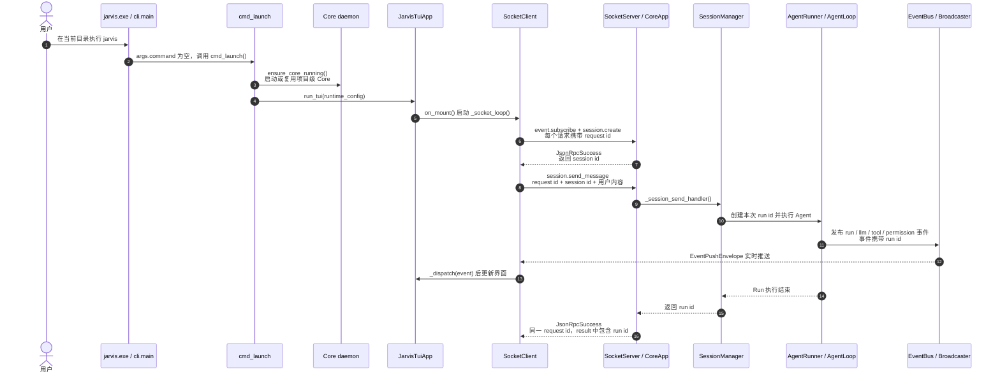
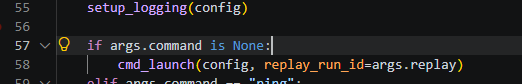
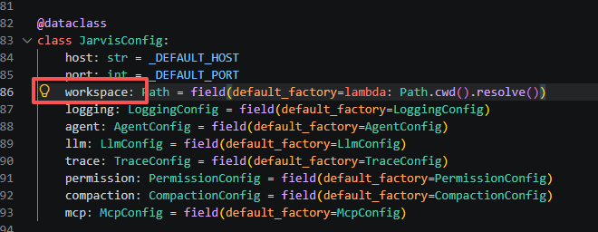
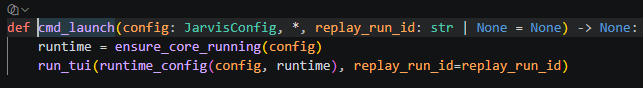
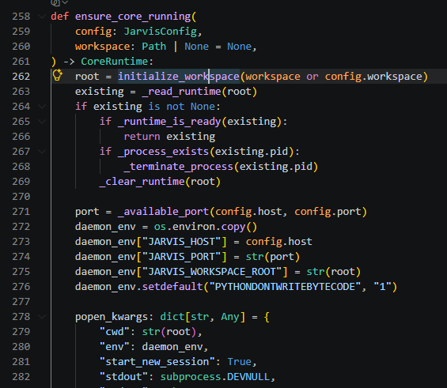
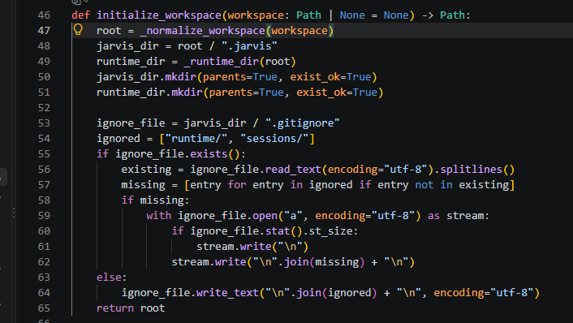
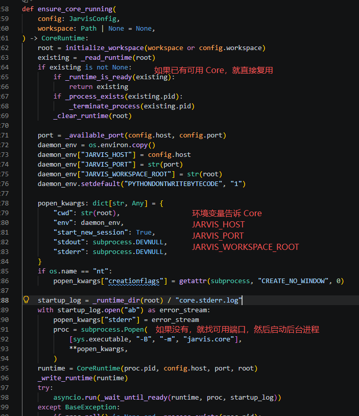
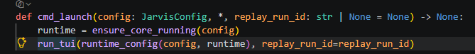

# Jarvis 七天源码阅读与面试指南

> 校对基准：2026-09-20，`main` 分支。
>
> 目标：按本文从 Day 1 读到 Day 7，只走一遍源码，就能讲清完整调用链，
> 并为简历中的 Tool、Context、Memory、Loop、Safety、Trace、Eval、
> Multi-Agent 八个方向建立源码证据。

## 使用方法

每天投入 4～6 小时，严格执行当天的四件事：

1. 按表格顺序阅读源码，不从目录树随机跳读。
2. 围绕“读完要回答的问题”理解代码，不追求记住每个辅助函数。
3. 运行当天列出的测试，确认理解与真实行为一致。
4. 完成当天产出，形成可直接用于面试的材料。

七天安排如下：

| 天数 | 阅读主题 | 对应简历方向 | 当天最终产出 |
|---|---|---|---|
| Day 1 | `jarvis` 启动器、TUI、协议和双进程通信 | 架构基础、Trace 的 IPC 部分 | 完整请求时序图 |
| Day 2 | Session、Runner、Context、Loop、Provider | Context、Loop | ReAct 主循环图 |
| Day 3 | Tool 与权限治理 | Tool、Safety | 工具调用安全链 |
| Day 4 | Memory 与上下文压缩 | Memory、Context | 三层状态与压缩图 |
| Day 5 | Event、Trace 与 TUI 展示 | Trace | 故障定位流程 |
| Day 6 | Skills、Sub-Agent、MCP | Tool、Multi-Agent | 扩展机制对比表 |
| Day 7 | BFCL Eval 与面试收口 | Eval、全部八条 | 简历证据表和模拟面试 |

七天只遵循这一套顺序。后面的设计取舍、改进方向和面试题用于复习，不要求重新阅读源码。

---

## Day 1：`jarvis` 启动器、TUI 与 Core

这里的 CLI 不是主要交互界面。用户只在终端输入一次 `jarvis`，后续提问、
流式回答、工具展示和权限审批都在 TUI 中完成。

Day 1 阅读 `cli/main.py`、`launch.py` 和 `commands/core.py`，只为理解启动过程：

```text
jarvis 命令入口 -> 以当前目录初始化 workspace -> 启动或复用 Core -> 打开 TUI
```

不需要阅读 `chat.py`、`run.py`、`trace.py` 等命令式客户端，也不需要学习两套交互方式。

### 今日目标

回答一个问题：

> 在任意目录输入一次 `jarvis` 后，当前目录如何变成 workspace，程序如何进入
> TUI，TUI 又如何通过 TCP 把用户消息交给 Core？

### 阅读顺序

不要把下面文件当成十几个孤立模块。按“启动链、命令上行链、事件下行链”
跟踪同一条消息；同一文件会在不同阶段回看不同函数。

#### 第一段：启动链

| 顺序 | 文件或位置 | 只看什么 | 读完应知道什么 |
|---:|---|---|---|
| 1 | `src/jarvis/cli/main.py` | 只看 `args.command is None` 分支 | 裸 `jarvis` 为什么进入 `cmd_launch()` |
| 2 | `src/jarvis/cli/commands/launch.py` | 只看 3 行核心调用 | 先保证 Core 可用，再把真实运行信息交给 TUI |
| 3 | `src/jarvis/cli/commands/core.py` | `initialize_workspace()`、`ensure_core_running()`、`runtime_config()` | 当前目录、`.jarvis`、动态端口和后台 Core 怎样准备好 |
| 4 | `src/jarvis/tui/__main__.py` | `run_tui()` | 怎样创建 `JarvisTuiApp`，以及 `app.run()` 是进入 TUI 事件循环的分界点 |
| 5 | `src/jarvis/tui/app.py` | `JarvisTuiApp.__init__()`、`compose()`、`on_mount()`、`_socket_loop()` | TUI 挂载后怎样启动 Socket worker、连接 Core、订阅事件并创建 Session |

读到这里先停下来，能说出：

```text
run_tui()
  -> JarvisTuiApp(...)
  -> app.run()
  -> on_mount()
  -> run_worker(_socket_loop())
  -> SocketClient.connect()
```

#### 第二段：命令上行链

继续只跟踪 `_socket_loop()` 中的这一条：

```python
await client.send_command("session.create", {"mode": "chat"})
```

| 顺序 | 文件或位置 | 只看什么 | 读完应知道什么 |
|---:|---|---|---|
| 6 | `src/jarvis/core/transport/socket_client.py` | `connect()`、`send_command()`、`run_event_loop()` | TUI 怎样生成 request id、写入一行 JSON，并用 Future 等待响应 |
| 7 | `src/jarvis/core/bus/envelope.py` | `JsonRpcRequest`、`JsonRpcSuccess`、`JsonRpcError` | 刚才发送和等待的 JSON 外层格式是什么 |
| 8 | `src/jarvis/core/bus/commands.py` | 先只看 `EventSubscribeCommand`、`SessionCreateCommand`、`SessionSendMessageCommand`、`PermissionSetModeCommand` | `params` 进入具体 handler 后怎样被校验 |
| 9 | `src/jarvis/core/transport/socket_server.py` | `start()`、`_read_loop()`、`_handle_line()` | Core 怎样读取 JSON 行、按 method 查 handler，并用相同 request id 返回结果 |
| 10 | `src/jarvis/core/app.py` | `run()` 中的 `server.register(...)`，再看 `_subscribe_handler()`、`_session_create_handler()`、`_session_send_handler()` | `"session.create"` 等字符串怎样映射到真正的领域逻辑 |
| 11 | `src/jarvis/tui/app.py` | 回看 `_socket_loop()`，再看 `_do_send_message()` | 启动时怎样订阅并创建 Session；用户按 Enter 后怎样发送 `session.send_message` |

命令上行链应能连成：

```text
TUI send_command("session.send_message", params)
  -> JsonRpcRequest(id, method, params)
  -> TCP 中的一行 JSON
  -> SocketServer._handle_line()
  -> handlers["session.send_message"]
  -> CoreApp._session_send_handler()
  -> SessionManager.send_message()
  -> JsonRpcSuccess(同一个 id)
  -> SocketClient._dispatch()
  -> 唤醒 send_command() 等待的 Future
```

`SessionManager.send_message()` 之后怎样进入 Agent Loop 留到 Day 2，不要在 Day 1
继续向下钻。

#### 第三段：事件下行链

命令响应只告诉 TUI“请求完成或返回了哪个 id”；模型 token、工具进度和权限请求
通过另一条事件推送链实时返回。

| 顺序 | 文件或位置 | 只看什么 | 读完应知道什么 |
|---:|---|---|---|
| 12 | `src/jarvis/core/bus/events.py` | 先看 `RunStartedEvent`、`LlmTokenEvent`、`ToolCallStartedEvent`、`PermissionRequestedEvent`、`RunFinishedEvent` | Core 内部会产生哪些关键状态，不必第一遍背全 |
| 13 | `src/jarvis/core/transport/ipc_broadcaster.py` | `subscribe()`、`handle()` | EventBus 事件怎样按 topic/scope 包装为 `EventPushEnvelope` 并写回订阅连接 |
| 14 | `src/jarvis/core/transport/socket_client.py` | 回看 `_dispatch()` 的 `kind == "event"` 分支 | 客户端怎样区分 JSON-RPC 响应和服务器推送事件 |
| 15 | `src/jarvis/tui/app.py` | 回看 `_socket_loop()` 中的 `on_event()`，再看 `_handle_event_inner()` | `llm.token`、`tool.*`、`permission.*` 怎样变成界面内容 |

事件下行链应能连成：

```text
Agent 组件发布 Event
  -> EventBus
  -> IpcEventBroadcaster.handle()
  -> EventPushEnvelope(kind="event")
  -> 同一条 TCP 连接
  -> SocketClient._dispatch()
  -> TUI on_event()
  -> _handle_event_inner()
  -> 更新界面
```

### 当天调用链

```text
当前目录执行 jarvis
  -> 命令入口读取配置
  -> initialize_workspace()
  -> ensure_core_running()
  -> 后台启动 python -m jarvis.core
  -> run_tui()
  -> JarvisTuiApp.app.run()
  -> on_mount() 启动 _socket_loop()
  -> SocketClient 连接 Core
  -> event.subscribe / session.create / permission.set_mode
  -> 用户输入触发 session.send_message
  -> SocketServer 按 method 路由到 CoreApp handler
  -> JSON-RPC 响应按 request id 返回
  -> Core 事件经 IpcEventBroadcaster 推回 TUI
```

### 验证

```powershell
uv run pytest tests/unit/test_cli_main.py `
  tests/unit/test_core_command.py `
  tests/unit/test_commands_events.py `
  tests/unit/test_envelope.py `
  tests/unit/test_socket_client.py `
  tests/unit/test_socket_server.py `
  tests/unit/test_core_app.py `
  tests/integration/test_ping_roundtrip.py -q
```

### 当天产出

画一张不超过 15 个节点的请求时序图，必须同时包含：

- `jarvis` 启动器进入 TUI 的路径；
- TUI 到 Core 的命令路径；
- Core 到 TUI 的事件路径；
- request id、session id、run id 三种标识的作用。

#### Day 1 请求时序图



三种 ID 不要混：

| ID | 谁创建 | 生命周期 | 作用 |
|---|---|---|---|
| `request id` | `SocketClient.send_command()` | 一次 RPC 请求到对应响应 | 让 `_dispatch()` 找到正在等待该响应的 Future |
| `session id` | `SessionManager.create()` | 一段多轮对话 | 后续消息、权限模式和历史都归属同一个 Session |
| `run id` | `SessionManager.send_message()` | Session 中的一次 Agent 执行 | 关联本次 Loop 的事件、工具调用、Trace 和运行结果 |

只用一句话复述整张图：

> `jarvis` 启动或复用 Core 后进入 TUI；TUI 使用带 request id 的
> JSON-RPC 命令创建 Session 并发送消息，Core 为每条消息创建 run id；
> Agent 执行期间通过事件流实时更新 TUI，执行结束后再用相同 request id
> 返回包含 run id 的 JSON-RPC 响应。


产出：

`src/jarvis/cli/main.py`：命令行输入jarvis：`jarvis` 命令从哪里来

在 [pyproject.toml (line 22)](../pyproject.toml#L22) 中配置了： Python 包管理工具会在 PATH 目录中生成一个 `jarvis.exe` 启动脚本。

```
[project.scripts]
jarvis = "jarvis.cli.main:main"
jarvis-core = "jarvis.core.app:run"
jarvis-tui = "jarvis.tui.__main__:main"
```

 由于参数是空  先config = get_config() 后  直接走到



`get_config()`    config类创建时  创建配置时，workspace 默认就是当前目录：



直接调用`src/jarvis/cli/commands/launch.py`



首先确定core在running，来到src/jarvis/cli/commands/core.py  -->initialize_workspace



initialize_workspace:初始化工作区

```
D:\my-project\.jarvis\
D:\my-project\.jarvis\runtime\
D:\my-project\.jarvis\.gitignore
```



然后Core 如何自动启动？  还是这里



Core 准备好以后调用run_tui




---

## Day 2：Session、Context 与 Agent Loop

### 今日目标

回答一个问题：

> 一条用户消息怎样变成一次 Run，并在 LLM、工具和上下文之间循环，直到生成最终答案？

### 阅读顺序

| 顺序 | 文件 | 重点 | 读完应知道什么 |
|---:|---|---|---|
| 1 | `src/jarvis/core/session/model.py` | `Session`、`SessionMode`、`SessionStatus` | Session 与 Run 的边界 |
| 2 | `src/jarvis/core/session/manager.py` | `create()`、`send_message()`、`compact()` | 一条消息如何创建 Run、展开 Skill 并调用 Runner |
| 3 | `src/jarvis/core/runner.py` | `_build_registry()`、`run_and_capture()` | 一次 Run 如何组装 Provider、工具、权限、上下文和事件记录 |
| 4 | `src/jarvis/core/context.py` | 整个文件 | messages、tool_use、tool_result 和 Run 状态如何维护 |
| 5 | `src/jarvis/core/prompt.py` | `build_runtime_system_prompt()`、`finalization_system_prompt()` | Windows、工具策略和步数限制如何进入系统提示词 |
| 6 | `src/jarvis/core/llm/base.py` | `LLMProvider` Protocol | Loop 为什么不依赖具体模型厂商 |
| 7 | `src/jarvis/core/llm/types.py` | `LlmResponse`、`ToolCallBlock`、`UsageStats` | Provider 向 Loop 返回的统一数据结构 |
| 8 | `src/jarvis/core/llm/provider.py` | `chat()`、`DeepSeekProvider`、`create_llm_provider()` | Anthropic/DeepSeek 如何适配成统一 Provider |
| 9 | `src/jarvis/core/loop.py` | `AgentLoop.run()` 逐行读 | LLM、Tool、Observe、结束条件和最终总结轮 |

### 当天主链

```text
SessionManager.send_message()
  -> 追加用户消息
  -> 创建 run_id
  -> AgentRunner.run_and_capture()
  -> 组装 ExecutionContext
  -> AgentLoop.run()
  -> Provider.chat()
  -> assistant text / tool_use
  -> tool_result 回填
  -> 下一次 Provider.chat()
  -> end_turn 或 finalization turn
```

### 验证

```powershell
uv run pytest tests/unit/test_session_manager.py `
  tests/unit/test_runner.py `
  tests/unit/test_context.py `
  tests/unit/test_context_system_prompt.py `
  tests/unit/test_prompt.py `
  tests/unit/test_llm_provider.py `
  tests/unit/test_loop.py -q
```

### 当天产出

1. 画出一次完整 ReAct 循环。
2. 准备 Context 和 Loop 两个 60 秒回答。
3. 写清这三个对象各自不负责什么：

```text
SessionManager：不执行 Agent 循环
AgentRunner：不决定每一步如何循环
AgentLoop：不关心 TUI 如何展示
```

---

## Day 3：Tool 与 Safety

### 今日目标

回答一个问题：

> 模型返回一个工具调用后，Jarvis 怎样完成查找、校验、审批、执行、重试和结果回填？

### 阅读顺序

| 顺序 | 文件 | 重点 | 读完应知道什么 |
|---:|---|---|---|
| 1 | `src/jarvis/core/tools/base.py` | `BaseTool`、`ToolResult` | 所有工具遵守什么接口 |
| 2 | `src/jarvis/core/tools/registry.py` | 注册、查询、Schema 汇总 | 内置工具、Sub-Agent 和 MCP 为什么能统一进入 Loop |
| 3 | `src/jarvis/core/tools/builtin/project_map.py` | 目录映射和忽略策略 | 大项目为什么先 map 而不是递归读文件 |
| 4 | `src/jarvis/core/tools/builtin/search_files.py` | 文本与文件搜索 | Agent 如何缩小代码阅读范围 |
| 5 | `src/jarvis/core/tools/builtin/read_file.py` | 分段读取、大小限制 | 大文件如何避免一次塞满上下文 |
| 6 | `src/jarvis/core/tools/builtin/bash.py` | Windows PowerShell、超时、输出截断 | Shell 如何适配平台并限制输出 |
| 7 | `src/jarvis/core/tools/builtin/write_file.py` | 写入校验和大小限制 | 文件写入有哪些局部保护 |
| 8 | `src/jarvis/core/permissions/policy.py` | 默认策略、allow/deny、越界启发式 | 静态权限评估顺序 |
| 9 | `src/jarvis/core/permissions/storage.py` | `policy.toml` | Always 决策如何跨 Session 持久化 |
| 10 | `src/jarvis/core/permissions/manager.py` | `check_and_wait()`、`respond()`、`set_session_mode()` | Future 审批、Ask/Auto、缓存和断连清理 |
| 11 | `src/jarvis/core/tools/invocation.py` | `invoke_tool()` | 参数校验、权限、超时、错误分类、重试和事件发布 |

### 当天主链

```text
模型返回 tool_use
  -> ToolRegistry.get()
  -> Pydantic 参数校验
  -> PermissionManager.check_and_wait()
  -> 用户审批或策略自动决策
  -> asyncio.wait_for(tool.invoke())
  -> 可恢复错误指数退避重试
  -> ToolResult
  -> context.add_tool_result()
  -> 模型再次决策
```

### 验证

```powershell
uv run pytest tests/unit/test_tool_registry.py `
  tests/unit/test_tool_params.py `
  tests/unit/test_builtin_tools.py `
  tests/unit/test_repository_tools.py `
  tests/unit/test_read_file.py `
  tests/unit/test_permission_policy.py `
  tests/unit/test_permission_manager.py `
  tests/unit/test_invocation.py `
  tests/unit/test_tool_retry.py `
  tests/integration/test_s5_permission_flow.py -q
```

### 当天产出

1. 画出工具调用安全链。
2. 准备 Tool 和 Safety 两个 60 秒回答。
3. 明确面试表述：

```text
已经实现：工具安全治理链路
尚未实现：文件系统或进程级安全沙箱
```

---

## Day 4：Memory 与上下文压缩

### 今日目标

回答一个问题：

> Jarvis 的短期状态、会话历史和跨会话规则分别存在哪里，又怎样避免历史无限增长？

### 阅读顺序

| 顺序 | 文件 | 重点 | 读完应知道什么 |
|---:|---|---|---|
| 1 | `src/jarvis/core/config.py` | 配置加载优先级、workspace、LLM 和压缩参数 | Global/Project 配置怎样覆盖 |
| 2 | `src/jarvis/core/session/store.py` | meta、thread、notes、compact backup | Session 数据如何落盘 |
| 3 | `src/jarvis/core/memory/loader.py` | `load_context_file()` | Global/Project Context 如何读取 |
| 4 | `src/jarvis/core/tools/builtin/note_save.py` | Notes 写入 | Agent 如何主动保存同一 Session 后续仍有用的信息 |
| 5 | `src/jarvis/core/compact/budget.py` | tool result 截断 | 局部确定性压缩怎样控制大结果 |
| 6 | `src/jarvis/core/compact/compactor.py` | `compact()`、`compact_messages()` | LLM 摘要如何替换长历史 |

### 三层状态

| 层级 | 保存内容 | 存储位置 | 生命周期 |
|---|---|---|---|
| Run Working State | 当前消息、工具结果、step、status | `ExecutionContext` 内存 | 单次 Run |
| Session Memory | 完整 thread、关键 Notes、Run 目录 | `.jarvis/sessions/<sid>/` | 同一 Session 多个 Run |
| Cross-Session Context | 用户规则、项目约定 | `~/.jarvis/context.md`、项目 `.jarvis/context.md` | 跨 Session，用户维护 |

第三层里的 Global/Project 是两个作用域，不是两个独立记忆层。当前没有自动学习长期偏好。

### 验证

```powershell
uv run pytest tests/unit/test_config_env.py `
  tests/unit/test_session_store.py `
  tests/unit/test_memory_loader.py `
  tests/unit/test_note_save_tool.py `
  tests/unit/test_budget.py `
  tests/unit/test_compactor.py `
  tests/integration/test_s4_session_ipc.py -q
```

### 当天产出

1. 画出 Run、Session、Cross-Session 三层状态图。
2. 准备 Memory 的 60 秒回答。
3. 用一句话区分：

```text
Memory 决定信息存在哪里、保留多久；
Context 决定当前请求向模型注入哪些信息。
```

---

## Day 5：Event、Trace 与故障定位

### 今日目标

回答一个问题：

> 一次模型调用或工具调用失败后，怎样从 TUI、events、Trace 和日志中定位具体环节？

### 阅读顺序

| 顺序 | 文件 | 重点 | 读完应知道什么 |
|---:|---|---|---|
| 1 | `src/jarvis/core/events/bus.py` | subscribe、publish | 领域组件如何解耦事件消费者 |
| 2 | `src/jarvis/core/events/writer.py` | `EventWriter` | Run 事件如何落到 `events.jsonl` |
| 3 | `src/jarvis/core/trace/record.py` | Trace 数据结构 | IPC、Event、LLM 如何进入统一时间线 |
| 4 | `src/jarvis/core/trace/writer.py` | 后台队列写入 | Trace 为什么不直接阻塞主流程写文件 |
| 5 | `src/jarvis/core/trace/provider.py` | LLM 包装器 | 模型请求、响应、耗时如何记录 |
| 6 | `src/jarvis/core/transport/ipc_broadcaster.py` | topic、scope、回传 | EventBus 事件如何推回客户端 |
| 7 | `src/jarvis/core/logging_setup.py` | text/json logging | 普通运行日志解决什么问题 |
| 8 | `src/jarvis/core/runs.py` | Run 路径辅助函数 | Run 数据怎样定位 |
| 9 | `src/jarvis/tui/app.py` | 搜索 `LLMStreamBlock`、`ToolCallBlock`、权限审批、复制逻辑 | 结构化事件怎样变成可交互 UI |

### 可观测性分工

| 数据 | 主要用途 |
|---|---|
| 普通日志 | daemon 生命周期、异常堆栈、组件运行状态 |
| `events.jsonl` | 单次 Run 的领域事件回放 |
| Trace | IPC、EventBus、LLM 三层调用与延迟关联 |
| `thread.jsonl` | 可再次发送给模型的会话消息历史 |

### 验证

```powershell
uv run pytest tests/unit/test_event_bus.py `
  tests/unit/test_event_writer.py `
  tests/unit/test_trace_writer.py `
  tests/unit/test_tracing_provider.py `
  tests/unit/test_ipc_broadcaster.py `
  tests/unit/test_tui_app.py -q
```

### 当天产出

选择一次工具失败案例，写出固定排查顺序：

```text
TUI 看到错误
  -> 按 run_id 找 events.jsonl
  -> 按 tool_use_id 找 tool.call.failed
  -> 查看 error_class 和 attempt
  -> 在 Trace 中检查 LLM/IPC 前后事件
  -> 必要时查看 core.log 异常堆栈
```

准备 Trace 的 60 秒回答。

---

## Day 6：Skills、Sub-Agent 与 MCP

### 今日目标

回答一个问题：

> Jarvis 怎样在不修改 Agent Loop 的情况下增加工作流、子 Agent 和外部工具？

### 阅读顺序

| 顺序 | 文件 | 重点 | 读完应知道什么 |
|---:|---|---|---|
| 1 | `src/jarvis/core/skills/loader.py` | 搜索优先级、frontmatter、参数展开 | Skill 怎样变成角色指令与工具白名单 |
| 2 | `src/jarvis/core/skills/builtin/init.md` | 项目初始化工作流 | 内建 Skill 是随安装包分发的 Prompt |
| 3 | `src/jarvis/core/skills/builtin/orchestrate.md` | 子 Agent 编排提示 | Skill 怎样指导模型调用 Sub-Agent |
| 4 | `src/jarvis/core/agents/loader.py` | Profile 搜索和解析 | Agent 角色如何配置化 |
| 5 | `src/jarvis/core/agents/builtin/planner.toml` | Planner 指令与工具权限 | 规划角色怎样限制职责 |
| 6 | `src/jarvis/core/agents/builtin/executor.toml` | Executor 指令与工具权限 | 执行角色怎样限制职责 |
| 7 | `src/jarvis/core/agents/builtin/reviewer.toml` | Reviewer 指令与工具权限 | 审查角色怎样限制职责 |
| 8 | `src/jarvis/core/subagent/registry.py` | 后台 task/context 注册 | 当前后台任务怎样保存和查询 |
| 9 | `src/jarvis/core/subagent/tool.py` | `spawn_agent`、`agent_result`、事件桥接 | 前台/后台子 Agent 如何执行 |
| 10 | `src/jarvis/core/mcp/client.py` | JSON-RPC MCP 客户端 | 外部进程工具怎样发现与调用 |
| 11 | `src/jarvis/core/mcp/tool.py` | MCP Tool Adapter | 外部工具怎样适配成 BaseTool |
| 12 | `src/jarvis/core/mcp/server.py` | 多 Server 生命周期 | MCP Server 如何启动、聚合和关闭 |

### 三种扩展机制

| 机制 | 本质 | 是否执行独立 Loop | 是否提供新工具 |
|---|---|---:|---:|
| Skill | Prompt 模板 + 工具白名单 | 否 | 否 |
| Sub-Agent | 隔离上下文中的子 Agent | 是 | 通过 `spawn_agent` 暴露 |
| MCP | 外部工具协议适配 | 否 | 是 |

### 验证

```powershell
uv run pytest tests/unit/test_skill_loader.py `
  tests/unit/test_agent_profile_loader.py `
  tests/unit/test_spawn_agent_tool.py `
  tests/unit/test_mcp_tool.py -q
```

### 当天产出

1. 完成 Skill、Sub-Agent、MCP 对比表。
2. 准备 Multi-Agent 的真实现状回答：

```text
已实现：隔离上下文、角色 Profile、前台阻塞、后台 asyncio.Task、
事件桥接、任务注册表、agent_result 查询。

未实现：Session 级子任务状态机、join barrier、并发上限、
超时取消、完成驱动结果投递。
```

3. 决定简历处理方式：
   - 普通后端/AI 应用岗位：不单列 Multi-Agent，在 Tool 中保留 Sub-Agent。
   - Agent Infra 岗位：可以单列，但只能写已经实现的能力。

---

## Day 7：BFCL Eval 与面试收口

### 今日目标

回答两个问题：

> 工具调用能力怎样被可复现地评测？
>
> 简历中的每一句话，能否指出源码、测试、数据和当前边界？

### 第一部分：阅读 BFCL 可复现分支

BFCL 代码不在 `main`，而在独立 worktree：

```text
C:\Users\23148\.codex\worktrees\bfcl-reproducible-eval\KamaClaude
```

该分支尚未完成 Jarvis 包名迁移，因此源码路径仍是 `src/kama_claude/`。

按顺序阅读：

| 顺序 | 文件 | 重点 |
|---:|---|---|
| 1 | `repro/bfcl/README.md` | 环境、数据、运行命令和产物 |
| 2 | `repro/bfcl/BFCL_OFFICIAL.md` | 官方数据和 Checker 的来源 |
| 3 | `src/kama_claude/evals/bfcl_data.py` | 数据加载和类别过滤 |
| 4 | `src/kama_claude/evals/bfcl_agentic.py` | AgentLoop 模式怎样生成工具调用 |
| 5 | `src/kama_claude/evals/bfcl_scorer.py` | 官方结果怎样映射成评分 |
| 6 | `src/kama_claude/evals/bfcl_reporting.py` | accuracy、coverage 和分类汇总 |
| 7 | `src/kama_claude/evals/bfcl_runner.py` | CLI、断点续跑和单 Case 执行 |
| 8 | `src/kama_claude/core/tools/argument_normalizer.py` | 参数规范化、拒绝和审计 |
| 9 | `src/kama_claude/core/tools/result_budget.py` | 工具结果预算治理 |
| 10 | `repro/bfcl/reports/kama-responses-luna-static-normalizer-v1.json` | run identity、摘要和分类结果 |

### Eval 验证

在 BFCL worktree 中执行：

```powershell
uv run pytest tests/unit/test_tool_argument_normalizer.py `
  tests/unit/test_tool_result_budget.py `
  tests/evals/test_bfcl_data.py `
  tests/evals/test_bfcl_scorer.py `
  tests/evals/test_bfcl_reporting.py `
  tests/evals/test_bfcl_runner.py -q
```

### 第二部分：完成简历证据表

| 简历方向 | 当前可以写什么 | 主要源码证据 | 当前边界 |
|---|---|---|---|
| Tool | 统一工具接口、注册、参数校验、结果回填，接入 Skills/Sub-Agent/MCP | `tools/base.py`、`registry.py`、`invocation.py`、`runner.py` | 工具权限仍有启发式规则 |
| Context | 分层注入规则、角色、项目说明、Notes、历史与工具结果 | `context.py`、`prompt.py`、`runner.py` | 尚未实现按任务语义选择上下文 |
| Memory | Run 工作状态、Session thread/notes、Cross-Session Context | `context.py`、`session/store.py`、`memory/loader.py` | Global/Project 由用户维护，不会自动学习 |
| Loop | ReAct、多工具调用、失败回填、步数控制、最终总结轮 | `loop.py`、`llm/provider.py` | 当前单模型 static routing |
| Safety | 参数校验、权限策略、审批、超时、重试和审计 | `permissions/`、`tools/invocation.py` | 不是文件系统或进程级沙箱 |
| Trace | Event、Run 文件、LLM/IPC Trace、TUI 实时展示 | `events/`、`trace/`、`ipc_broadcaster.py` | EventBus 缺少独立订阅者队列和背压 |
| Eval | BFCL 官方数据与 Checker、参数规范化审计 | BFCL 分支 `evals/`、`repro/bfcl/` | 结果来自独立分支 |
| Multi-Agent | 隔离上下文、角色、前后台执行、事件桥接、结果查询 | `subagent/`、`agents/` | 没有 join barrier 和 Session 状态机 |

### 第三部分：完成三版项目介绍

#### 30 秒版本

只回答：

- Jarvis 是什么；
- 解决什么问题；
- 六个 Harness 核心是什么；
- 一个最有说服力的量化结果。

#### 3 分钟版本

按下面顺序：

```text
项目目标
  -> Core daemon + TUI client 架构
  -> Agent Loop
  -> Tool + Safety
  -> Context + Memory
  -> Trace
  -> Eval
  -> 当前边界和下一步
```

#### 10 分钟版本

在 3 分钟版本基础上增加：

- 一次完整请求时序图；
- 一个工具失败后的恢复案例；
- 一个设计取舍；
- 一个 Trace 定位案例；
- 四项改进 Roadmap。

### Day 7 完成标准

- 可以白板画出完整架构；
- 八条简历方向都能指出源码和测试；
- 能主动说出至少四个当前边界；
- 不把尚未实现的能力写进简历；
- 能解释 BFCL 数字的来源和复现方法。

---

## 完整调用链

七天读完后，应能脱离代码讲出：

```text
jarvis
  -> 当前目录成为 workspace
  -> 启动或复用项目级 jarvis-core
  -> TUI 创建 Session
  -> SocketClient 发送 JSON-RPC
  -> SocketServer 路由 CoreApp handler
  -> SessionManager 追加消息并创建 Run
  -> AgentRunner 组装 Context、Provider、Tool、Permission、Trace
  -> AgentLoop 调用 LLM
  -> 模型返回 text 或 tool_use
  -> ToolRegistry 查找工具
  -> 参数校验和权限审批
  -> 工具执行、超时、重试
  -> tool_result 回填 Context
  -> LLM 再次决策
  -> EventBus 发布结构化事件
  -> EventWriter / TraceWriter 持久化
  -> IpcEventBroadcaster 推送 TUI
  -> SessionStore 保存 thread 与 notes
  -> end_turn 或最终总结轮结束
```

---

## 设计取舍、当前边界与改进

| 主题 | 当前取舍 | 当前边界 | 后续改进 |
|---|---|---|---|
| daemon + TUI client | Core 统一执行，TUI 通过协议驱动任务，长任务不绑定界面生命周期；`jarvis` 命令只负责启动与诊断 | 增加 IPC、进程和端口管理复杂度 | 快速返回 run_id，强化断线恢复和 daemon 会话恢复 |
| EventBus | Loop 只发布结构化事件，可同时驱动 TUI、Events 和 Trace | 顺序 await，慢订阅者可能拖慢主流程 | 每订阅者独立队列、并发派发与背压策略 |
| Tool failure | 错误作为 tool_result 回填，模型可以换方案继续 | 重复失败可能浪费步骤和 Token | 失败模式检测、熔断和动态升级模型 |
| Context | 分层注入规则、历史、Notes 和工具结果 | 每次注入偏静态，缺少按任务相关性选择 | Context selector、检索、分模块摘要和 Token 预算 |
| Memory | Session 持久化，Global/Project 由用户控制 | 没有自动长期偏好学习，也不能完整恢复 daemon 内存索引 | 候选偏好提取、用户审批、作用域、去重、更新、删除和语义检索 |
| Model routing | 配置保留 router 字段，但 Provider 实际 static | 所有任务使用同一模型，小任务成本和延迟偏高 | 简单任务走小模型，复杂/高风险任务升级；同时裁剪 Prompt 和 Tool Schema |
| Permission | Ask/Always/Auto 降低误操作和审批疲劳 | Auto 绕过静态检查，路径判断不是强隔离 | Ask、Workspace Auto、Full Auto 分级权限 |
| Sandbox | 当前使用策略、审批、超时和错误治理 | 不能阻止绝对路径、Junction、子进程或网络逃逸 | 规范化路径、只读挂载、受限 Token/Job Object/AppContainer 或容器、网络和资源限制 |
| Multi-Agent | 隔离上下文，支持前台/后台任务和结果轮询 | 主 Agent 可能在关键子任务结束前输出；没有并发治理 | Session 状态机、required 标记、完成事件、join barrier、并发上限、超时取消 |
| Eval | 独立分支固定 BFCL 数据与 Checker，保留参数审计 | 与 main 存在代码漂移风险 | 合并公共 Eval 基础设施，持续评测质量、成本、延迟与安全 |

面试时优先讲四项 Roadmap：

1. Multi-Agent join barrier：提升复杂任务的完成一致性。
2. 分级模型路由与上下文预算：简单任务用小模型，失败或复杂任务自动升级。
3. 自动长期偏好：参考 HermesAgent 的思路，但加入作用域、审批、冲突与删除机制。
4. 文件系统与进程级安全沙箱：把当前安全治理升级为真实执行隔离。

这些只能作为改进方向，不能写成已经实现。

---

## 面试题

### 架构与 IPC

1. 为什么要拆成 Core daemon 与 TUI client，而不是直接在 TUI 进程中运行 Agent？
2. JSON-RPC 响应和事件推送怎样在同一 TCP 连接上共存？

### Loop 与 Provider

3. 工具执行失败后为什么不立即结束 Run，最大步骤耗尽后又为什么增加 finalization turn？
4. 如果加入大小模型路由，你会用哪些信号做决策，失败后怎样升级？

### Tool 与 Safety

5. 为什么参数校验、权限审批和工具执行不放在 BaseTool 内部？
6. 当前权限系统为什么不能称为安全沙箱，Windows 下怎样升级为真正隔离？

### Context 与 Memory

7. Context 和 Memory 有什么区别，thread、notes 和 context.md 分别解决什么问题？
8. 自动学习长期偏好时，怎样处理错误记忆、冲突、过期和用户隐私？

### Trace 与故障定位

9. events.jsonl、Trace、thread.jsonl 和普通日志有什么区别？
10. 如何根据 run_id、step 和 tool_use_id 定位一次失败？

### Multi-Agent 与扩展

11. Skill、Sub-Agent、MCP 的本质区别是什么？
12. join barrier 应放在哪里，怎样处理超时、失败和 required/optional 子任务？

### Eval

13. BFCL 的 Accuracy、Coverage 和 Attempt Accuracy 分别说明什么？
14. 为什么参数规范化必须可审计？
15. 怎样证明模型路由降低成本后没有显著伤害任务成功率？
16. 如果要评测安全沙箱，应该增加哪些攻击用例？
