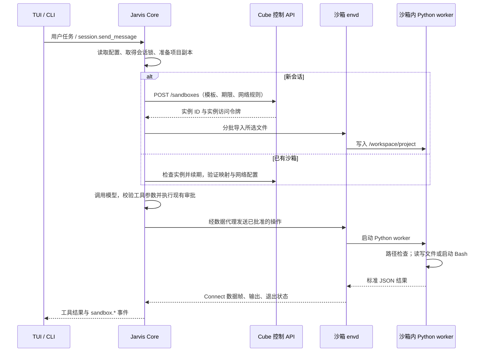

# Jarvis 的 CubeSandbox 执行后端

第一版保留现有 Agent Loop、模型接口、审批和 TUI；替换项目工具的实际执行位置。主 Agent、前台和后台 Sub-Agent 的 Shell、读写、列目录、搜索、项目结构工具都共用同一个 MicroVM 和 `/workspace/project`。任务与笔记等会话数据继续由 Core 管理。

## 工具调用与沙箱内部流程



新会话仅导入一次项目，后续工具调用读取和修改同一份文件。每次操作会启动一个短期 worker，工作区和沙箱实例持续保留；模型和 Agent Loop 始终运行在 Core。

Core 不安装 E2B SDK，直接使用 httpx 调用 Cube 的控制接口及 envd 协议。小请求通过受控启动命令传入；大请求先上传到沙箱内随机临时文件，worker 读取后删除。worker 的源码每次由 Core 提供，沙箱中的项目代码无法替换 Core 的辅助实现。

worker 只依赖 Python 标准库。文件工具将路径限制在 `/workspace/project`，并检查链接及导出大小；Shell 在该目录启动 `/bin/bash --noprofile --norc`，返回退出码和合并输出。普通超时会终止命令进程组；取消整段任务会请求销毁整个实例，以终止脱离原进程组的子进程。网络连接由创建实例时交给 Cube 的策略约束。

当前本机部署经过 Windows → WSL2 → 部署 Cube 服务的 Linux 虚拟机 → 任务 MicroVM。控制请求负责创建、续期和销毁，数据代理把操作转发给目标实例内的 envd；沙箱内只拿到任务操作及项目文件，不拿到 Core 的管理凭证。

## 生命周期事件与记录

| 事件 | 含义 |
| --- | --- |
| `sandbox.starting` | 准备新实例与项目副本 |
| `sandbox.created` | Cube 已返回实例 ID，项目尚在导入 |
| `sandbox.ready` | 文件导入完成，可执行工具 |
| `sandbox.reused` | 已验证旧实例并续期 |
| `sandbox.using` | 已批准的工具操作或变更导出使用沙箱 |
| `sandbox.released` | 本轮使用结束，保留实例；`state_unknown` 表示连接故障后状态待确认 |
| `sandbox.stopping` | 正在请求销毁，尚未确认成功 |
| `sandbox.destroyed` | 控制接口已确认删除，或确认实例已不存在 |
| `sandbox.failed` | 创建、执行、导出或销毁失败；`destruction_unconfirmed` 不表示进程已停止 |

每条事件携带 `session_id`、`run_id`、`sandbox_id`、操作、原因、UTC 时间戳和当前操作累计耗时；工具使用事件另有 `tool_name`。并发 Sub-Agent 的使用事件带各自的 run ID，共用同一个实例 ID。

事件通过 EventBus 广播给 trace、IPC 和会话记录。trace 启用时写入 UTF-8 日志；TUI 默认订阅 `sandbox.*`，其他客户端可通过 `event.subscribe` 订阅。任务中的事件同时写入对应 run 的 `events.jsonl`；手动管理操作的事件写入会话的 `execution/events.jsonl`。

`thread.jsonl` 里的审计记录形如 `{"kind":"event","ts":"...","run_id":"...","event":{...}}`。它们不冒充 user/assistant 消息，载入模型历史时会跳过；会话恢复和历史压缩会保留这些记录。事件不包含命令参数、文件内容、管理 API Key 或实例访问令牌。

`jarvis sandbox status/changes/apply/stop` 现在经 `sandbox.manage` IPC 进入 Core，必要时自动启动 Core，因此 CLI 发起的销毁也会广播给已经连接的 TUI。正常任务结束或关闭聊天界面保留沙箱供恢复；显式 stop 和取消任务触发销毁。Cube 自身的闲置到期清理由服务端处理，Jarvis 不在后台轮询，此类消失会在下次连接时报告失败。

## 启用

先启动本机部署：

```powershell
& D:\CubeSandbox\Start-CubeSandbox.ps1
```

项目 `.jarvis/config.toml` 添加：

```toml
[execution]
backend = "cubesandbox"
connection_file = "D:/CubeSandbox/client/connection.env"
sandbox_timeout = 3600
allow_internet_access = false
allow_out = []
deny_out = []
include_uncommitted = ["src/**/*.py", "tests/**/*.py"]
exclude = []
```

再重启 Jarvis Core，让它加载新配置；已有本地会话建议新建会话开始使用。`jarvis core stop` 后正常启动 `jarvis`。也可使用 `JARVIS_EXECUTION_BACKEND` 和 `JARVIS_CUBE_CONNECTION_FILE` 覆盖后端与连接文件路径。

连接文件只由 Core 读取 Cube API、模板和本机数据代理地址。模型 API Key、Cube 管理凭证、权限设置及会话历史均不上传。不依赖 E2B SDK 的版本或本地 DNS 修改，使用现有 httpx 与 envd 协议。

## 项目副本

- Git 仓库需要从仓库根目录启动。默认导入已提交的文件；有未提交修改的已跟踪文件默认取 `HEAD` 内容。
- `include_uncommitted` 是明确的文件路径/glob 选择。匹配的文件采用当前磁盘内容，含未跟踪文件与已删除文件。`["*"]` 表示选择全部工作区文件修改（内置排除仍有效）。
- 非 Git 的小项目导入当前文件。
- 永久排除 `.git`、`.jarvis`、`.agents`、`runs`、`.tasks`、常见缓存/依赖目录、`.env*`、私钥/证书、常见凭据文件与 `config.toml`。Core 的自定义运行目录也从导入中排除。另扫描明显的私钥和固定凭据格式。文件名与内容检查无法识别任意自定义秘密文件，请把此类路径加入 `exclude`。
- 不导入/回传符号链接、junction、特殊文件；回传拒绝硬链接、Windows 保留名称、大小写冲突与路径越界。
- 默认上限：25,000 个文件、单文件 2 MB、项目 50 MB；可在 `[execution]` 设置 `max_files`、`max_file_bytes`、`max_total_bytes`。
- 原项目不挂载进虚拟机；沙箱删除文件只影响副本。文件工具默认路径均相对 `/workspace/project`，Shell 使用 Linux Bash。

被排除的文件或未选定的本地改动不会偷偷随项目上传；查看导入清单：

```powershell
jarvis sandbox status --session sess-你的会话ID
```

## 检查并回传

在原项目目录运行：

```powershell
jarvis sandbox changes --session sess-你的会话ID
```

命令输出新增、修改、删除及文本 diff，并生成一个 Review ID；此时不改动本地项目。完整内容保存在 `.jarvis/sessions/<ID>/execution/reviews/<Review ID>.json`，二进制文件内容用 base64 保存。

检查完成后执行命令输出的：

```powershell
jarvis sandbox apply --session sess-你的会话ID --review REVIEW_ID --confirm REVIEW_ID
```

模型没有 `apply` 工具。应用读取已检查的那份固定内容；沙箱后来发生的新修改不会混入。所有目标文件先检查哈希，应用前再检查一次；发现本地冲突则整批拒绝，不覆盖。未选入副本的原有脏文件若被沙箱修改，也算冲突。无关文件里的本地修改保留。原始文件另备份在 Core 的 `execution/backups` 下，写入失败时尝试回滚本批已写入内容。

同一会话的执行、导出、回传使用跨进程锁；运行中请等待任务结束再检查和应用。应用时也请暂停外部编辑器的自动保存，避免哈希检查与文件替换之间的并发竞态。第一版不做自动合并；冲突时展示列表，由用户手动处理。

## 网络、生命周期和取消

新会话按配置设置网络，默认禁用外网。`allow_out` / `deny_out` 直接交给 Cube 的网络策略，支持其 IP/CIDR/域名规则；域名白名单需同时禁用默认外网访问。修改网络配置后需新建会话，旧会话会拒绝复用，避免静默沿用旧策略。沙箱数据接口始终要求实例访问令牌，Host 转发仅指向本机部署的代理。

会话元信息保存后端与 sandbox ID；访问令牌保存在 Core 的 `execution/sandbox.json`。连续调用和重新启动 Core 后均复用这一个实例，默认每次运行续期 3600 秒。超时删除、服务端实例丢失或导入中断会报错，不自动换新实例，不降级到 Windows。

TUI 用 **Ctrl+X** 取消当前任务，IPC 方法为 `session.cancel`。取消会销毁本会话整个 MicroVM，终止命令及脱离父进程的子进程，因此需要新建会话继续；取消前应先完成需要保留的变更导出。普通 Shell 超时在沙箱内杀死命令进程组并返回超时结果。关闭单次命令连接不等于取消整段任务，正常会话保持到超时或手动停止。

```powershell
jarvis sandbox stop --session sess-你的会话ID
```

第一版在隔离模式下禁用所有宿主 MCP 连接，包括 stdio 和 TCP，避免工具绕过执行后端。需要的 MCP 后续再部署进 MicroVM。Skills 文本与角色配置仍由 Core 加载；其本机资源路径不会自动映射到沙箱，所需项目资源应通过副本导入。

## 验证

不需要真实模型密钥的单元测试：

```powershell
uv run pytest tests/unit/test_execution_copy.py tests/unit/test_execution_routing.py -q
```

使用已部署 CubeSandbox 的验收（会创建短期实例并清理）：

```powershell
$env:JARVIS_TEST_CUBE = "1"
uv run pytest tests/integration/test_cube_execution.py -v
```

验收用可控的模型响应驱动真实 Jarvis Loop、权限管理与工具链，验证改代码/运行测试、同一工作区、会话复用、本地副本保护、审阅回传、网络允许/拒绝以及取消后销毁实例。不会调用外部模型 API。

## 本机验收记录（2026-11-02）

- 全功能回归最终通过 424 项：全量运行 423 项通过，Skills 字节完整性检查修复后单独复测 1 项通过；包含生命周期审计、并发子 Agent 的事件归属、历史恢复与压缩保留事件。
- 已部署 CubeSandbox 的真实集成验收：4 项通过，含网络允许/拒绝、通过会话取消正在执行的命令，以及真实 IPC 上的 EventBus / thread.jsonl / trace / 客户端事件一致性检查。
- 当前 Jarvis 仓库：231 个所选文件成功复制进真实实例；沙箱内 Python 3.12.12 编译源码通过，文件工具读到了当前未提交的后端实现；临时实例已清理。
- Ruff 检查、执行后端安全规则扫描、103 个源码文件的 mypy 检查、协议文档一致性检查通过。
- 本项目 `.jarvis/config.toml` 已启用 CubeSandbox，默认禁止外网，并选择源码、测试、脚本及文档的未提交修改。已有模型配置保留；Core 已启动，直接运行 `jarvis` 并新建会话即可使用。

JUnit 报告位于 `D:/CubeSandbox/logs/jarvis-regression.xml`（全量原始结果）、`D:/CubeSandbox/logs/jarvis-skills-recheck.xml`（修复后复测）与 `D:/CubeSandbox/logs/jarvis-integration.xml`（实机验收）。这些验收没有调用付费模型；真实模型的回答质量不属于此次验证范围。
