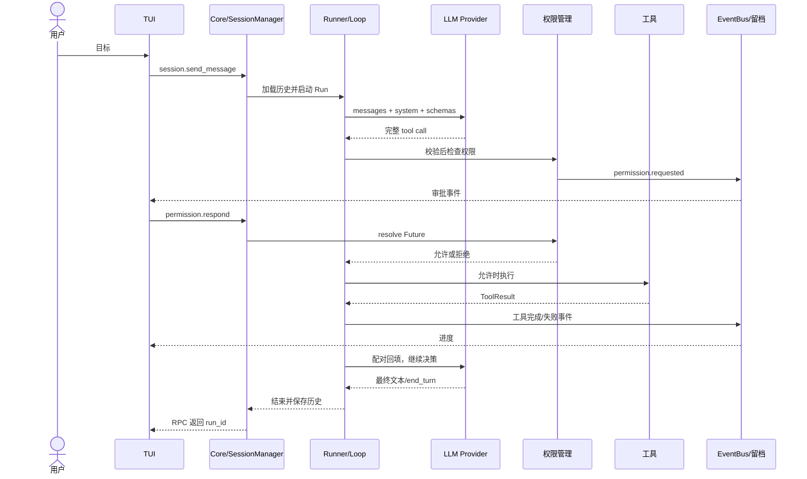

# Jarvis 面试准备：一份文档完成冲刺与查漏

> 核对日期：2026-10-08。针对马腾简历里的 Jarvis 项目。本文件把已核对的实现翻译成流程、状态、伪代码和口述答案，可以独立学习，不要求打开源码或另搜资料。
>
> **判断：可以把源码阅读暂时放下。** 对常规后端或 AI 应用岗位的项目问答，这份材料加闭卷口述，可以作为这几天的主要准备。先读前九节，掌握完整执行过程和连续追问；124 道详细问题已合并到本文件附录，不要求全部读完。
>
> 如果面试要求现场改项目、解释任意函数或深挖 Agent 基础设施实现，文档不能保证替代实践。当前最有价值的目标是：把核心链路讲清楚、能解释异常和取舍，诚实说明已做与未做。个人贡献、真实故障和开发经历仍需按自己的情况回答。


**只按这一份复习：前九节必读，附录按需。** 每题的原理、实现和异常已经写在正文里，不需要为了完成复习打开源码或其他文档。来源链接仅用于证据留存。

- [复习时间安排](#1-时间这样分配)
- [三条完整执行链](#4-不读源码也要能讲清这三条链)
- [18 个核心回答](#5-十八个核心回答先讲第一段再接追问)
- [20 分钟闭卷模拟](#8-二十分钟闭卷模拟题目和评分点都给你)
- [最后十分钟速记](#9-面试前最后十分钟只看这里)
- [详细追问附录](#10-详细追问附录按需查阅)

## 1. 时间这样分配

### 剩三天：每天给 Jarvis 约两小时

| 时间 | 读哪些内容 | 必须做的输出 |
|---|---|---|
| 第一天 | 第 2～4 节：介绍、术语、三条链路 | 合上文档讲三分钟；画请求链、工具链、审批链 |
| 第二天 | 第 5～7 节：18 个回答、故障、评测 | 每题回答 30～60 秒；讲两个异常过程；手算三个比例 |
| 第三天 | 第 8～9 节：模拟题与速记 | 做两遍 20 分钟模拟，只回看答不出的内容；确认个人贡献 |

每天两小时可按 **40 分钟理解 + 40 分钟闭卷讲 + 40 分钟纠错** 分配。不要把全部时间花在反复阅读。

### 只剩一天：约四小时

1. 第一小时读第 2～4 节，能讲完整请求和工具闭环。
2. 第二小时学第 5 节，优先卡片 01、02、05、06、08、09、12、13、14、16。
3. 第三小时读第 6～7 节，练两个故障过程和评测数字。
4. 第四小时用第 8 节闭卷模拟，再看第 9 节速记；填清个人贡献。

### 只剩半天，最少也要掌握这六件事

- 一句话解释 Harness，并说清“本地运行、API 模型”。
- 一条用户请求如何经过 TUI、Core、Loop、工具和事件。
- 工具如何校验、审批、执行、回填；为什么审批不会卡住读循环。
- Run/Session/跨 Session、截断/摘要的区别，自动压缩默认关闭。
- BFCL 的分子分母、选定类别和真实规范化规则。
- 两个可以具体说明的设计取舍，以及自己的真实贡献。

## 2. 能直接练习的项目介绍

### 30 秒版

> Jarvis 是一个本地 Code Agent Harness。它把模型调用、文件和 Shell 工具、权限审批、上下文管理和执行追踪组织成完整运行时。用户通过 TUI 提交任务，Core 守护进程执行工具闭环，并把过程事件实时推回来。我还在独立评测分支上基于 BFCL v4 的选定类别建立了评测链路，3,638 条已评分样例的准确率是 79.16%，评分覆盖率是 99.92%。

“我还……”只在确实符合你的贡献时使用；否则改为“项目还包含……”。

### 约两分钟版

> 这个项目要解决的是：模型会提出动作，但如果没有运行时，不能可靠地连接到本地工作区、持续执行任务或解释哪里出了问题。
>
> 架构上，我把 TUI 和 Core 拆成两个进程。TUI 负责输入、展示进度和审批；Core 管理任务、模型调用和工具执行。两者通过本地 TCP 通信，用换行分隔 JSON 消息，请求响应使用 JSON-RPC，进度使用自定义事件封装。这样执行体和界面的生命周期可以解耦。
>
> 执行上采用 ReAct 风格闭环：把目标、历史和工具定义发给模型，模型返回完整工具调用，运行时进行参数校验、权限检查、超时执行，再把成功或错误结果配对回填，让模型继续决定下一步。同轮多个工具当前串行执行；到步骤预算后会留一个不带工具的总结轮。
>
> 状态上分 Run、Session 和跨 Session。Run 保存单次执行状态，Session 保存历史和 Notes，全局与项目 context 文件保存可复用规则。工具历史读取时做长结果截断，也支持摘要压缩；自动压缩默认关闭，需要配置启用。
>
> 安全和观察方面，有异步审批、执行超时、有限重试和事件/Trace 记录。它目前是运行时安全治理，还不是系统级沙箱。评测结果来自独立分支的 13 个选定类别，覆盖率指完成评分的比例，不能当成完整官方 BFCL 总分。

**被打断时：**先回答当下的问题，结束后用“这对应的是刚才的工具执行/上下文/权限这一层”接回主线。别执着把介绍稿讲完。

## 3. 十几个词，先在脑子里对上实物

| 词 | 本项目里到底是什么 |
|---|---|
| Harness | 模型周围的运行时：接工具、管状态、约束执行、留证据 |
| Core daemon | 在本机后台执行任务的进程 |
| TUI | 终端交互界面，展示文本、工具进度和审批 |
| Provider | 把不同模型 API 适配成统一调用接口的组件 |
| Loop | 反复“调模型→执行工具→回填→再调模型”的控制流 |
| ToolRegistry | 工具名到工具对象的字典，以及可给模型的工具定义集合 |
| Schema | 工具参数的结构说明，包含类型、必填项等 |
| Context | 这一轮模型实际看到的规则、历史和工具结果等输入 |
| Memory | 跨轮或跨会话保存、之后能加载的信息 |
| Future | 等将来某个响应才能继续的结果对象 |
| Task | 被事件循环调度执行的协程任务 |
| EventBus | 将结构化事件交给注册订阅者的进程内总线 |
| Trace | 记录请求、模型调用与事件等过程，辅助关联排查 |
| ReAct | 根据观察反馈继续决定动作的思路 |
| MCP | 外部工具发现和调用协议；不是模型，也不是自动推理循环 |

### 四种 ID，不要混

```text
request_id：配一次 RPC 请求和响应
session_id：归属一段多轮对话及权限作用域
run_id：归属一次 Agent 执行，关联过程事件
tool_use_id：配一次工具调用、审批和工具结果
```

Session 可以包含多个 Run；一条 Run 可以有多个模型轮次；一轮可以有多个工具调用。request_id 目前没有承担业务去重，所以“重发相同请求”不保证只执行一次。

## 4. 不读源码，也要能讲清这三条链

### 链一：从“帮我修登录问题”到一次执行结束

这是说明机制的场景，不是你已经完成过的真实任务案例。

```text
1. TUI 把目标和 session_id 发给 Core。
2. SocketServer 解析完整 JSON 行，按 method 找 handler。
3. SessionManager 检查 Session、加该 Session 的锁。
4. 保存用户消息，创建 run_id。
5. Runner 加载历史、Notes、全局/项目 context，注册工具。
6. Loop 把 system + messages + 工具 Schema 交给模型。
7. 模型提出 search_files、read_file 等完整工具调用。
8. 运行时执行工具，把结果按 tool_use_id 回填。
9. 模型继续，可提出 write_file、Shell 检查等动作。
10. 执行中，模型 token、工具、审批事件不断发给 TUI 并留档。
11. end_turn 或预算后的总结轮收尾；异常按失败处理。
12. 保存新增对话消息，更新 Session 状态，返回结果。
```

**关键细节：**`session.send_message` 当前在 Run 结束后才返回 RPC 响应，过程中靠事件更新界面；`agent.run` 则启动后台任务后立即返回 run_id。不能把两种接口都说成“立即返回”。

**为什么 Session 加锁？**同一个会话两条消息同时推进，历史会交错、工具结果可能归属不清。当前已忙就返回 SESSION_BUSY；不同 Session 有不同锁，可以交错推进。

**工作区怎么来？**用户在哪个目录启动，启动器就以该目录为工作区，建立项目 `.jarvis/runtime`，启动或复用该项目的 Core，并让 Core 使用该目录作为工作目录。工作目录不是安全沙箱。

### 链二：一次工具调用的完整生命周期

```text
模型输出：name=read_file，id=call_1，input={path: ...}
  → 发布工具开始事件
  → Registry 查工具
  → 有 params_model 时做参数校验
  → 权限检查；必要时等审批
  → 限时调用 tool.invoke
  → 成功，或按规则有限重试/返回错误
  → 发布完成/失败事件
  → ToolResult 回填给模型，关联 call_1
```

三个对象的主要字段，不必背类定义：

```text
工具定义：name、description、input_schema、可选 params_model、invoke
模型调用：id、name、input
工具结果：content、is_error、可选 error_type
```

**新增工具怎么做？**提供这些接口，注册到 Registry，再配置权限与验证；Loop 继续走同一个执行入口。当前 Registry 同名会覆盖，因此需要避免命名碰撞；MCP 工具加 server 前缀降低冲突。

**校验和执行是什么关系？**校验检查结构，执行才产生动作。当前统一入口只调用校验，不保存其返回模型，执行仍传原 dict，内建工具往往再次解析。若被深追问，可说后续希望让校验、审批、执行共享一份明确参数。

### 链三：为什么审批既能等待，又不会阻塞整个服务

```text
工具遇到 ASK
  → 保存 pending[tool_use_id] = Future
  → 发布 permission.requested
  → TUI 展示审批
  → 执行协程 await Future，让出事件循环
  → 用户决定后，TUI 发 permission.respond
  → Core 用调用 ID 找 Future，设置允许/拒绝
  → 原工具协程继续执行，或返回拒绝结果
```

**最值得讲的细节：**SocketServer 对每条请求创建独立 Task，读循环继续读下一条命令。如果直接在读循环里等待长任务，长任务又在等审批，那么审批响应也读不到，会形成等待环。这里的独立 Task 是为了解开这个依赖。

**审批超时：**默认 60 秒，未回复就拒绝；配置为 0 表示不设超时。这个等待发生在工具执行 timeout 之前。

### 伪代码一：Loop，记住控制流就够

```text
while Run 仍在 running:
    step += 1
    response = 调模型(messages, system, tools)
    将 assistant 的文本和 tool_use 加入 messages

    如果处于最终总结轮：
        保存最终文本，正常收尾
    否则如果 response 是 tool_use：
        对每个调用串行执行 invoke_tool
        按调用 ID 把 tool_result 加回 messages
    否则如果输出截断且存在不完整工具调用：
        不执行，补配对的错误结果

    如果 end_turn：正常收尾
    否则如果 step 到预算：下一轮关闭工具，要求总结
    如果配置启用且条件满足：摘要压缩
```

这是教学化的控制流概括。取消、异常、事件发布等分支已经在文字回答中补充，现场不必逐行复现项目代码。

### 伪代码二：审批与重试要分开

```text
查工具、校验参数
检查权限：拒绝就结束这次调用，不偷偷重试
获准后，最多 3 次执行尝试：
    wait_for(tool.invoke, 默认 120 秒)
    成功：返回结果
    runtime_error 或 rate_limited：还有次数则等 2/4 秒重试
    timeout 或其他不可重试错误：返回错误
```

不存在的工具与 Schema 错误在进入执行重试循环前就返回。重试是工程机制，不保证副作用安全；当前 runtime_error 重试范围偏宽，写操作需要幂等或结果确认。

## 5. 十八个核心回答：先讲第一段，再接追问

每张卡的第一段可以练到 30～60 秒，不必逐字背。追问回答要和第一段逻辑一致。

### 01. 为什么是 Harness，而不是套壳聊天？

**回答：**它不仅接收模型文本，还负责提供工具、执行动作、管理消息和 Run 状态、限制权限与预算、保存过程。模型给出的工具调用只有经过运行时才能作用于工作区。核心是把“建议”变成有反馈和约束的执行闭环。

**追问：本地模型吗？**不是这个意思。本机运行 Core 和工具，模型通过 API 调用，所以文件内容可能进入远程请求。

### 02. 为什么拆双进程？不拆行吗？

**回答：**单进程也能做，但长任务、界面和执行状态会绑定在一起。现在 Core 专门执行，TUI 专门交互，能够复用执行体并独立演进客户端；代价是必须处理启动发现、连接、协议和断线。拆进程是职责与生命周期取舍。

**追问：关 TUI 一定不影响吗？**执行体可以继续，但审批、断线与状态恢复还不完善，不能承诺任何断线都无影响，更不能等同于 Core 崩溃恢复。

### 03. asyncio 具体用在哪里？

**回答：**网络和 IPC 读取、模型流、审批 Future、工具子进程和后台 Agent 都存在等待。协程在 await 点让出执行机会，其他任务可以推进，适合这种 I/O 密集链路。它并不把 CPU 密集计算自动并行化。

**追问：async 函数里同步写文件呢？**仍可能阻塞事件循环；当前有同步存储操作，规模大时需要有界写队列或合适的执行器。

### 04. TCP 粘包和请求配对怎么解决？

**回答：**TCP 是字节流，用一行一个 JSON 分帧，readline 后再解析。JSON-RPC 请求带 id，客户端保存 pending Future，响应按 id 唤醒；进度是自定义 kind=event 封装，另走事件分发。网络到达顺序不必等于请求完成顺序。

**追问：重发相同 id 就幂等？**不是。当前 id 主要配响应；业务去重还要 submission_id→run_id 和存储中的执行记录。

### 05. ReAct 和 Tool Calling 区别是什么？

**回答：**Tool Calling 是模型结构化提出工具名称和参数的接口；ReAct 是根据行动结果继续决策的执行思路。项目用前者驱动后者，工具输出包括错误会成为下一轮观察。模型能发调用不等于已经有完整 Loop。

**追问：失败后谁来修？**运行时对特定错误有限重试；错误结果交给模型后，模型也可换路径或换方案。两层恢复不能混，权限拒绝不能被偷偷绕过。

### 06. 多工具调用怎么实现？是并行吗？

**回答：**模型同一轮可返回多个调用，Loop 保留每个调用 ID，逐个执行并回填。主 Loop 当前串行。后台子 Agent 创建 Task 后能交错运行，这是另一层并发。BFCL 的 parallel 类别也不证明主工具调度使用并行。

**追问：想并行怎么办？**先找独立性：只读可考虑并发；同文件写和有依赖的操作保持顺序，再加并发限额、冲突治理、结果配对和取消。

### 07. 为什么单独设计 ToolRegistry 和 invoke_tool？

**回答：**Registry 解决工具发现与 Schema 暴露；invoke_tool 解决校验、权限、超时、重试和事件；具体 Tool 只承担功能执行。把共同治理放到统一入口，能避免新增工具时漏掉审批或超时，也让 Loop 不依赖具体工具。

**追问：MCP 也统一校验？**统一执行入口不等于所有工具有同样校验。当前 MCP 工具 params_model=None，Schema 主要来自外部工具定义，本地严格验证仍有补强空间。

### 08. 怎么结束？如何避免死循环？

**回答：**正常 end_turn 收尾；LLM 异常失败；取消传播；工具轮到步骤上限后再做一个关闭工具的总结轮。步数限制按模型轮次算，一轮能有多个工具，还会发生执行重试，所以不是严格时间/费用总预算。

**追问：success 等于任务完成？**不等于。当前总结轮也会标正常收尾，任务可能部分完成；应区分执行状态和业务验收。

### 09. 三层上下文与记忆是什么？

**回答：**Run 是单次执行状态与消息；Session 持久化多轮 thread 和 Notes；跨 Session 通过全局/项目 context 文件保存可复用规则。历史让模型知道之前发生过什么，Notes 保留关键结论，context 提供背景和规则。

**追问：自动学习用户偏好？**当前主要是文件和主动 Notes，没有完整自动提取、冲突更新、过期删除或向量检索系统。

### 10. 截断和压缩怎么做？

**回答：**历史加载时，工具结果超过 8,000 字符就保留前 4,000 字符并提示省略；不是 Token 数。摘要压缩则用模型把历史整理为目标、完成事项、约束、文件状态、TODO、关键数据，再用摘要替换历史。自动压缩默认关闭，手动可以触发。

**追问：有损吗？收益多少？**有损，摘要可能漏信息，截断也可能丢尾部错误。当前能证明有控制机制，没有经过对照就不能报节省比例；摘要调用本身也有成本。

### 11. 历史落盘就能崩溃恢复吗？

**回答：**用户消息先保存，过程事件执行中记录，新增模型/工具消息主要在 Run 结束后追加。文件存在不代表运行中状态、待审批和后台 Task 自动恢复；完整恢复还需 checkpoint、消息配对和副作用核对。

**追问：压缩有什么边界？**手动压缩明确改写存储，自动分支主要替换内存历史；Runner 还按旧历史长度取增量，静态阅读发现这条持久化路径需额外验证。别把它说成已保证无损续航。

### 12. 异步审批、Ask、Always、Auto 怎么回事？

**回答：**需审批时用 Future 暂停该动作，界面通过 RPC 决策。Ask/Auto 是交互模式；Always 是保存的允许/拒绝决策。默认 Shell 和写文件需要询问，读文件等通常允许。当前 Auto 优先放行所有工具，会绕过静态策略，不是安全的工作区自动模式。

**追问：Always 粒度？**Session 缓存以 session/tool 为键，持久层主要按 tool，较粗；未来希望按工作区、路径、动作和有效期授权。

### 13. 这算安全沙箱吗？超时就安全吗？

**回答：**这是参数、策略、审批和超时等运行时治理，不是操作系统隔离。cwd 不限制子进程访问其他文件或网络，正则也无法全面约束 Shell。真正沙箱需要文件、进程、网络和资源权限边界。

**追问：wait_for 会杀全部进程？**它取消等待的协程并等待清理，不一定准时结束，也不会自动杀整棵进程树。Shell 内层超时 kill 直接进程，进程树与取消清理仍要完善。

### 14. Trace 和普通日志不同在哪里？

**回答：**events.jsonl 记录 Run 领域事件，Trace 关联 IPC、模型和事件链路，thread 是续聊历史，普通日志辅助看组件异常与堆栈。失败时按 run_id 找工具事件，再按 tool_use_id 看参数、审批、attempt 和 error_class，定位失败阶段。

**追问：回放能原样重跑？**当前是过程复盘；确定性重执行还需冻结模型响应和环境、隔离副作用，没有证据支持已经实现。

### 15. Skill、Sub-Agent、MCP 为什么都要有？

**回答：**Skill 是工作流指令模板和工具白名单；Sub-Agent 在独立消息上下文跑一套 Loop；MCP 把外部工具适配进 Registry。它们分别扩展工作方法、子任务执行和工具来源。当前子 Agent 共用工作区，不等于独立文件系统。

**追问：完整 MCP 吗？子任务必等吗？**当前 stdio/自定义 TCP 适配有兼容边界；后台子任务靠查询收结果，没有强制 join barrier。不能宣称完整协议兼容或所有必要子任务都会自动等完。

### 16. BFCL 数字是什么？为什么可信？

**回答：**独立报告计划 3,641 题，已评分 3,638，正确 2,880，所以 accuracy=79.16%，coverage=99.92%。报告保留类别、官方版本、模型配置、每题结果和参数审计，可核查结果来源。它是选定 13 类的样例加权准确率，不是完整官方总分。

**追问：谁的能力？工具真执行了吗？**是模型、Provider、Loop 和参数处理共同构成的链路结果。静态题用无副作用调用确认，验证调用而非真实业务效果；没有消融不能说 Harness 单独提升了多少。

### 17. 无损规范化做了什么？

**回答：**Schema 声明 number 时，非 bool 的整数若能安全转为浮点且回转数值相等，就统一数值表示，并保存原值、变换值、规则与错误。不会把字符串猜成数字、补单位或修枚举，也不是完整 Schema 验证器。

**追问：为什么要相等检查？**大整数转浮点可能失去精度，比如 9007199254740993。保存原值是可审计；变换不改变数值才是无损，两者不是一回事。

### 18. 你怎么测试？下一步先改什么？

**回答：**Loop 用预设模型响应测试配对、错误和结束；权限用 spy 检查拒绝后没执行；IPC 启动真实 daemon 验证推送和审批；模型质量用任务集评测。后续优先选一个具体问题，如必要子任务 join 或上下文 checkpoint，用明确用例验收。

**追问：Mock 能证明任务成功率吗？**不能，Mock 测工程契约，真实模型的任务质量要另外评估。说“测试通过”之前，要明确你实际执行过哪一组验证。

## 6. 三组故障追问：练到能说出先后顺序

这些是基于实现的机制推演。可以回答“遇到这种情况我会这样排查”，不要未经确认说成自己过去处理过的事故。

### 场景 A：界面停住，用户认为模型卡死

**第一问：你从哪里查？**先找 run_id 和最新领域事件，不急着重启。

**第二问：看到 permission.requested 呢？**任务在等审批，检查界面是否展示、回应命令是否发出、Future 是否被 resolve。默认审批 60 秒超时拒绝。

**第三问：看到 tool.call_started 后没消息？**看权限是否通过、工具是否仍执行、是否到 timeout；工具执行前的等待与执行阶段分别看。

**第四问：Core 文件有新事件，TUI 没有？**优先查订阅 topic/scope、连接和慢客户端。EventBus 和广播当前逐个 await，慢 drain 可能影响主链。

**第五问：改进什么？**记录各阶段等待时间和 Run 状态；对慢消费者设有界队列；跟踪后台任务并统一取消。不是看到“没 token”就再发一次相同写请求。

### 场景 B：工具失败，模型反复调用同一条命令

**第一问：哪层重试？**先看 attempt：同 call_id 多次执行可能是工具自动重试；模型下一轮产生新的调用则是模型重新决策。

**第二问：为什么危险？**runtime_error 不证明没产生副作用；重复写入或提交可能重复执行，而且会耗步骤与费用。

**第三问：现在怎么办？**回填结构化失败，受步骤与现有权限限制。不要编造已经有重复调用熔断。

**第四问：怎么改？**先区分只读/幂等/不可重试工具，再增加相同调用指纹检测、重复失败上限、结果查询与总预算。对状态未知的外部写操作，优先确认结果。

### 场景 C：长会话继续执行时漏了前面结论

**第一问：先查什么？**当前请求有没有加载历史和 Notes？摘要是否遗漏目标/约束？工具结果是否被截断？

**第二问：压缩为什么可能出问题？**摘要有损；自动压缩替换消息列表后，旧增量下标可能不再适用。这里是待验证风险，本文未做运行时复现。

**第三问：完整方案？**保留原历史和关键结构化事实，压缩时更新 checkpoint/消息版本，确保摘要与后续消息持久化；重要动作前重新确认实际文件状态。

**第四问：怎么验收？**构造有长历史的 Session，触发压缩，再续聊，断言关键目标、工具配对和压缩后新消息保留。不是只断言“摘要非空”。

## 7. 评测速查：只记这些准确事实

### 三个比例

| 指标 | 公式 | 报告值 |
|---|---|---:|
| Accuracy | 正确 2,880 / 已评分 3,638 | 79.16% |
| Coverage | 已评分 3,638 / 计划 3,641 | 99.92% |
| Attempt Accuracy | 正确 2,880 / 计划 3,641 | 79.10% |

**分数与能力覆盖分开：**99.92% 是计划样例完成评分比例；不是测试覆盖率，也不是“BFCL 所有能力都测了”。报告覆盖 13 类，未包括 Web、Memory 和 multi-turn。

**三条未评分记录：**两题记录 runner_error/llm_error，一题记录 runner_error/exceeded_max_steps。没有更底层证据，不统一猜成网络失败。

**模型身份：**保存报告 Provider=responses，model=gpt-5.6-luna，model_profile=DeepSeek-V3.2-Exp-FC。profile 是评测配置名，不等于实际请求模型；报告字段也不构成对底层服务模型身份的独立验证。当前主仓库的 Provider 配置和这个评测分支要分开讲。

**官方性：**AST 类使用官方 checker，relevance 类按调用存在性规则适配结构化调用；原始数据、版本与类别可核对。自己的 harness 报告不等于官方完整榜单认证。

**审计数字：**3,699 次调用审计，226 次调用发生转换，53 次调用被拒绝，356 次规则命中。一次调用可以多个字段命中；这些不是题目条数，也不是提升正确题数。

### 一句话回答“你怎么证明规范化有用”

> 现有报告说明规范化发生了哪些变换，还不能单独证明收益。我会对同一份保存预测分别用原参数和规范化参数评分，比较每题变化；若要测其对后续 Loop 的影响，则固定配置重复端到端实验。

### 一句话回答“这是代码 Agent 任务成功率吗”

> 不是。这里重点评测工具调用链路和调用正确性；真实代码任务还要另用修复任务、测试通过、修改范围和人工验收等指标。

## 8. 二十分钟闭卷模拟：题目和评分点都给你

先遮住右栏，每题约一分钟。打分用 0/1/2：说不出=0；能讲主线=1；能补实现细节和边界=2。这个分数用于学习诊断，不是录用概率。

| 题目 | 讲出这些就过关 |
|---|---|
| 1. 用一分钟介绍 Jarvis | 本地运行/API 模型；Harness；执行闭环；一项真实报告 |
| 2. 画用户请求到完成的路径 | TUI→Core→Session→Runner/Loop→Provider/Tool→回填；事件/存储 |
| 3. 为什么双进程？ | 界面与执行解耦；代价是 IPC/生命周期；不保证崩溃恢复 |
| 4. TCP 怎么分帧、匹配响应？ | NDJSON/readline；id/Future；事件独立封装 |
| 5. 审批为何不会死锁？ | Future 等待；读循环独立 Task，仍能读 permission.respond |
| 6. 工具调用顺序是什么？ | 查工具→校验→权限→限时执行/重试→事件→配对回填 |
| 7. 多工具并行吗？ | 主 Loop 串行；后台 Sub-Agent 另有并发；需要依赖判断 |
| 8. 如何结束、会不会永远跑？ | end_turn/异常/取消/预算总结；step 不等于工具数；success 不等于完成 |
| 9. 三层记忆与压缩怎么工作？ | Run/Session/context 文件；8,000/4,000 字符；自动默认关闭；摘要有损 |
| 10. 参数校验保证安全吗？ | 不保证授权与隔离；Pydantic 可转换；MCP 验证边界 |
| 11. 权限模式和沙箱的边界？ | Ask/Auto 模式、Always 决策；Auto 优先允许；无 OS 隔离 |
| 12. 卡住/失败怎么查？ | run_id→阶段事件→tool_use_id/attempt/error→Trace/日志 |
| 13. Skill/Sub-Agent/MCP 怎么分？ | 工作流/子 Loop/外部工具；上下文隔离不等于文件隔离；无强制 join |
| 14. 79.16%/99.92% 怎么来？ | 2,880/3,638；3,638/3,641；13 类子集；非官方完整总分 |
| 15. 无损规范化是什么？ | 安全 int→float；精度检查；保留审计；不做字符串/单位猜测 |
| 16. 给一个你确认负责的模块 | 真实责任、具体设计、实际验证；不能只说负责全部 |
| 17. 给一个异常场景 | 能按先后讲状态和排查，不虚构已处理事故 |
| 18. 下一步先做什么、怎么验收？ | 选一个问题；解释理由；给有实际意义的验收条件 |

**合格目标：**核心题 1、2、5、6、9、11、14、15 没有 0 分；能连续讲完整链路并接三次追问。仍有 0 分就只补那题，不继续扩大题库。

### 四项必须由你自己确认，文档不能代填

1. 你实际负责哪些模块，协作者/AI 分别做了什么。
2. 你做过的一个取舍：为什么选择当前方式。
3. 你实际运行过什么验证，真实结果是什么。
4. 你确实遇到过什么问题；没有故障经历就讲机制分析，不编故事。

### 答不上来时这样接

**细节没记住：**“具体字段我没有记准，但这条链路是先校验、再审批、再执行，结果按调用 ID 回填。我不凭记忆编参数。”

**当前没做：**“目前做到的是【机制】，还没做到【边界】。若继续做，我会加【方案】，用【用例】验证。”

**被要求现场解释任意源码：**按真实情况说清熟悉的模块与准备范围，不能声称看过不熟悉的代码。会讲流程是项目理解证据的一部分，现场编码能力仍需单独验证。

## 9. 面试前最后十分钟只看这里

```text
定位：本机 Core/工具 + API 模型，Harness 提供执行与状态治理
架构：TUI 与 Core 双进程，项目级工作区/runtime
协议：TCP 字节流 + NDJSON 分帧 + JSON-RPC 请求响应
配对：request_id 配 RPC，tool_use_id 配动作/反馈
并发：每请求独立 Task，Session 加锁，主工具同轮串行
审批：发事件、等 Future、读响应；默认 60 秒超时拒绝
工具：查找→校验→权限→执行→有限重试→结果回填
重试：最多 3 次尝试，退避 2/4 秒，runtime/rate_limited 才走分支
执行：统一入口默认 120 秒；Shell 默认 60 秒；无统一总 deadline
Loop：end_turn 或异常/取消；预算后无工具总结；正常收尾≠任务完成
状态：Run 单次；Session thread/Notes；跨 Session 全局/项目 context
截断：历史工具结果 >8,000 字符，保留前 4,000，不是 Token
摘要：支持手动和配置启用自动；自动默认关闭；有损
安全：Ask/Auto 是模式，Always 是决策；Auto 优先放行；不是 OS 沙箱
追踪：events=领域过程，Trace=调用关联，thread=续聊，log=诊断
回放：复盘历史，不保证确定性重执行或崩溃恢复
扩展：Skill=指令，Sub-Agent=子 Loop，MCP=外部工具协议
子任务：独立消息上下文、共享工作区；后台查询，无强制 join
评测：2,880/3,638=79.16%；3,638/3,641=99.92%；13 类子集
规范化：保守 integer→number，检查精度，保留审计；不猜字符串/单位
个人贡献：按真实模块和实际验证讲
```

### 用一句话提醒自己

> 我现在不需要记住整个仓库，但要理解完整执行链、能解释失败过程、讲清取舍和证据。遇到超出范围的细节，就明确当前机制与边界。

## 10. 详细追问附录：按需查阅

这里保留完整 124 题。先学前九节；模拟时某个主题答不上来，才在本附录查对应问题。每题都有答案，源码和测试链接是依据，不是复习任务。

<details>
<summary>展开 124 道详细追问与参考答案</summary>

### 简历原句与证据边界

以下按 PDF 内容恢复换行和英文空格，不改动技术含义。

> **Jarvis：本地 Code Agent Harness**
>
> 简介：面向本地的 Code Agent，实现了 Harness 工程的工具、上下文、记忆、Loop、安全以及 trace 等核心部分。
>
> **整体架构：**设计 Core 守护进程与 TUI 双进程架构，基于 asyncio 和 JSON-RPC over TCP 实现任务提交、事件订阅与流式进度推送，支持在任意目录启动项目工作区。
>
> **Tool 与 Loop：**构建可扩展工具运行时与 ReAct 执行闭环，统一编排代码检索、文件读写、Shell、Skills、Sub-Agent 及 MCP 工具，支持多工具调用、失败结果回填与最终总结。
>
> **Context 与 Memory：**构建 Run、Session、跨 Session 三层上下文与记忆体系，持久化对话历史和关键 Notes，并通过工具结果截断与历史摘要压缩控制上下文长度和 Token 成本。
>
> **Safety 与 Trace：**通过参数校验、权限策略、异步审批、执行超时及失败重试约束高风险操作；统一记录模型、工具、权限和 IPC 事件，支持执行回放与故障定位。
>
> **Eval：**基于 BFCL v4 官方数据集与评分器构建端到端评测链路，在 3,638 条工具调用用例上取得 79.16% 准确率和 99.92% 覆盖率；实现基于工具 Schema 的无损参数规范化与审计记录。

#### 最容易被追问的十个口径

| 简历词语 | 当前证据支持的说法 | 面试时必须交代的边界 |
|---|---|---|
| 本地 | Core 和工具在本机运行，访问本地项目 | LLM 通过 API 调用，“本地”不等于模型离线，也不等于数据从不出机 |
| 双进程 | TUI 与 Core daemon 分离 | 长任务与窗口解耦不等于具备 daemon 崩溃恢复 |
| JSON-RPC | 请求/响应使用 JSON-RPC 封装，TCP 上按换行分帧 | 推送是自定义 `kind=event` envelope；不能宣称实现 JSON-RPC 全部特性 |
| 多工具调用 | 接收同轮多个 tool call，并逐个执行 | 主 Loop 当前串行；后台 Sub-Agent 可并发，是不同层次 |
| 三层记忆 | Run 工作状态、Session thread/notes、全局/项目 context 文件 | 当前不是自动学习偏好或向量检索系统 |
| 摘要压缩 | 有手动压缩与自动阈值触发代码 | `auto_threshold` 默认 `0.0`，自动压缩默认关闭；自动压缩后的持久化还需检查 |
| 安全 | 参数校验、审批、超时、重试、事件记录 | 不是系统级沙箱；Auto 模式优先放行，包含对静态拒绝规则的绕过 |
| 执行回放 | 根据事件和 Trace 查看历史执行过程 | 不保证模型与工具能确定性重执行，不保证外部副作用能恢复 |
| BFCL v4 | 使用 BFCL v4 数据与 checker 体系的选定类别 | 报告覆盖 13 类，不包括 Web、Memory 和 multi-turn；不是官方完整榜单总分 |
| 无损规范化 | `schema_safe_v1` 支持 Schema 约束下保持数值的 integer→number，并保存审计 | 不做字符串转数字、补单位、猜参数或改 enum；它也不是完整 JSON Schema validator |

### 一、项目名与简介

> 触发词：**本地 / Code Agent / Harness / 工具 / 上下文 / 记忆 / Loop / 安全 / trace**。

#### Q001【P0】Harness 是什么？你具体实现了什么？

**答：**Harness 是把模型接到实际任务上的运行时。模型提出工具调用，Harness 负责提供工具定义、维护对话状态、校验参数、检查权限、执行工具、回填结果，并控制步数、保存事件与历史。Jarvis 把这些组织成 Core daemon 中的执行链。模型负责生成下一步决策，运行时负责让决策变成受约束、可观察的动作。

**再追问：**如果只写一个调用模型的函数，缺什么？缺工具闭环、状态、取消、权限、预算和证据链。

#### Q002【P0】Code Agent 和普通聊天助手有什么区别？

**答：**聊天助手主要输出文本；Code Agent 可以围绕代码工作区检索、读写文件、执行检查，并根据工具结果继续决策。一次典型任务是“定位问题→改代码→跑检查→解释结果”。能调用工具只是前提，还需要循环控制和结束判定。

**再追问：**能生成代码就算完成任务吗？不能，是否落盘、能否通过检查、是否符合用户目标，都要有证据。

#### Q003【P0】“本地”是什么意思？模型也在本机吗？

**答：**本地指客户端、Core 和文件/Shell 工具运行在本机。当前主仓库 Provider 调用模型 API，不是本地模型推理。因此工作区内容可能进入模型请求；权限、上下文选择和 Trace 留存需要考虑数据边界。不能把本地运行说成完全离线。

#### Q004【P1】为什么自己做 Harness？为什么不直接用现成框架？

**答题思路：**围绕自己的真实目标讲：希望理解并掌控 IPC、工具执行、权限、上下文与评测的完整链路，选择较小的自建运行时。优点是控制流和证据清楚；代价是要自己承担协议兼容、安全和生命周期治理。现有仓库能证明设计与实现，不能证明你当时考察过哪些框架，没实际比较就不要编造选型过程。

#### Q005【P0】工具、上下文、记忆、Loop、安全、Trace 怎样配合？

**答：**Loop 控制下一步；Tool 执行动作；Context 是本轮给模型的输入；Memory 保存可复用信息；Safety 约束动作；Trace 保存过程证据。工具结果进入上下文，历史和 Notes 从存储加载进上下文，权限与失败产生事件，事件驱动界面和留档，所有部分在一次 Run 中衔接。

#### Q006【P0】一句用户请求的完整调用链是什么？

**答：**TUI 发 `session.send_message`，SocketServer 路由到 CoreApp；SessionManager 加锁、保存用户消息、创建 run；AgentRunner 加载历史、Notes 和项目规则；AgentLoop 调模型，收到 tool call 后通过统一入口执行；结果回填，模型继续；事件同步推到 TUI 并落盘；Run 结束后保存新增消息并更新 Session 状态。

```text
TUI → SocketClient → TCP/NDJSON → SocketServer → CoreApp
    → SessionManager → AgentRunner → AgentLoop → Provider
                                            ↓ tool calls
                                      invoke_tool → Tool
                                            ↓ results
                                        Context → 下一轮
    EventBus → TUI 推送 / events.jsonl / Trace
    SessionStore → thread.jsonl / notes.md / meta.json
```

#### Q007【P0】哪些是你本人做的？AI 帮了多少？

**答题模板：**“我主要负责的是【真实模块】，关键决定是【真实取舍】，可以从【函数/测试】说明控制流。AI 协助过【真实范围】，我用【真实验证】检查了实现。”不把仓库里所有代码默认归为个人独立完成。面试官往往会继续问：你能解释一个关键函数、指出一个不足、修改一个异常分支吗？

#### Q008【P1】你最有技术含量的一点是什么？

**答题思路：**选择一个你能讲到源码的点，如“异步审批与 IPC 并发避免死锁”“工具结果和消息配对的完整性”“BFCL 参数规范化的审计”。按问题→方案→取舍→证据讲，最多选两点，不堆名词。数字只能引用真实报告；没有消融就不宣称某机制带来了某百分比提升。

**源码入口：**[AgentRunner](../src/jarvis/core/runner.py)、[AgentLoop](../src/jarvis/core/loop.py)、[ExecutionContext](../src/jarvis/core/context.py)。

### 二、整体架构逐词拆

> 原句：设计 **Core 守护进程 / TUI / 双进程架构 / asyncio / JSON-RPC over TCP / 任务提交 / 事件订阅 / 流式进度推送 / 任意目录 / 项目工作区**。

#### Q009【P0】为什么拆 Core daemon 与 TUI 两个进程？

**答：**Core 持有任务状态、工具执行和模型调用，TUI 负责输入、进度与审批展示。长任务的执行体独立于界面，可以复用 Core 或接入其他客户端。代价是新增 IPC、进程启动、端口发现和断线治理。双进程解决的是职责和生命周期解耦，不自动解决持久化恢复。

#### Q010【P1】守护进程怎么启动、发现和复用？

**答：**启动器以当前工作区为根初始化 `.jarvis/runtime`，读取该项目的运行信息，并做就绪检查；可用则复用，否则清理旧运行信息并启动 `python -m jarvis.core`。启动子进程时传 workspace、host、port，设置工作目录，再等待就绪。不要只凭 PID 文件存在判断服务健康。

**追问：**PID 被复用、两个启动器同时启动怎么办？需要进程身份/启动时间核对、工作区启动锁和失败回滚。当前不要宣称已消除全部竞态。

#### Q011【P0】asyncio 相比多线程解决什么？

**答：**这个项目主要等待模型网络、socket、审批 Future 和子进程，适合协作式异步 I/O。协程在 `await` 处让出执行机会，使多个任务能推进；它不是让 Python 计算自动并行。纯 Python CPU 重任务通常需进程池或其他执行器，阻塞式 I/O 可考虑 `to_thread`。[S01]

#### Q012【P0】协程、Task、Future 有什么区别？

**答：**调用 `async def` 得到协程对象，直接创建它不等于已经调度。Task 把协程交给事件循环执行；Future 表示一个将来才有结果的对象。Jarvis 的 RPC 和审批把 Future 放进待处理表，收到匹配响应后设置结果，等待它的协程继续执行。

**追问：**`await coroutine` 与 `create_task(coroutine)`？前者等待这段逻辑结束；后者创建可独立调度的任务，之后仍应管理结果、异常和取消。

#### Q013【P1】有 `async def` 就不会阻塞吗？

**答：**不会。同步文件读写、`time.sleep`、大段计算都可能阻塞事件循环。当前 EventWriter 在异步函数里同步 `write/flush`，SessionStore 也同步读写；文件很小时简化实现可以接受，但不能称为全面非阻塞。扩展时应使用有界队列和写入 worker，并测事件循环延迟。[S01]

#### Q014【P0】JSON-RPC 和 TCP、NDJSON 各负责什么？

**答：**TCP 负责可靠有序字节传输；NDJSON 用“一行一个 JSON”提供消息边界；JSON-RPC 规定请求里的 `method/params/id` 和响应里的 `result/error`。它们分别处于传输、分帧和调用语义层。JSON-RPC 自身不指定必须使用 TCP。[S02]

#### Q015【P0】TCP 粘包、拆包怎么处理？

**答：**TCP 没有应用消息边界，不能假定一次 `read` 就是一条消息。这里把 JSON 序列化后追加 `\n`，用 `readline` 聚合完整一行再解析。字符串内部的换行应由 JSON 编码成转义字符，不能把原始多行文本直接写入帧。[S02]

**追问：**超长帧怎么办？两端设置了 64 MiB 行限制，但还要检查 `readline` 的异常分支、内存占用和发送前限额；大上限不是无限制的许可。

#### Q016【P0】请求响应与推送事件怎么共享一条连接？

**答：**客户端 `_dispatch` 先看是否有 `jsonrpc`；有则用响应 `id` 查 `_pending` Future。否则看 `kind == "event"`，交给事件回调。服务器推送是项目自定义 `EventPushEnvelope`，不是标准 JSON-RPC notification。标准 notification 是不带 `id` 的 request，服务端不返回响应。[S02]

#### Q017【P0】request_id、session_id、run_id、tool_use_id 分别是什么？

| 标识 | 关联范围 | 不能混淆的点 |
|---|---|---|
| request_id | 一次 RPC 请求和响应 | 响应配对标识，当前不承担业务幂等 |
| session_id | 多轮对话与权限作用域 | 一段会话可产生多个 Run |
| run_id | 一次 Agent 执行 | 贯穿事件、产物和执行状态 |
| tool_use_id | 一次模型工具调用 | 配对 tool_use/result、审批与重试记录 |

**答：**一次重试仍围绕同一个工具调用 ID，attempt 区分执行尝试；子 Agent 有自己的 run_id，再通过 parent_run_id 关联父任务。

#### Q018【P0】长任务在审批时，服务器为什么还能接收“允许”命令？

**答：**SocketServer 读循环对每一条请求创建独立 Task。如果在读循环中直接 `await session.send_message`，该任务可能挂在审批 Future 上，而同一连接的 `permission.respond` 无法再读取，形成等待环。独立处理 Task 让读循环继续消费审批命令。

**追问：**只换成 `create_task` 就完善了吗？还需要追踪 Task、观察异常、限制并发，并在退出时治理；当前读循环创建的处理 Task 缺少完整集合管理。

#### Q019【P1】同一个 Session 同时来了两条消息会怎样？

**答：**SessionManager 使用每个 Session 的 `asyncio.Lock`。若已锁定，返回 `SESSION_BUSY`，不会把两个 Run 的历史随意交错。不同 Session 使用不同锁，可以交错推进。当前约束是一会话一活动消息，不是所有会话串行。

#### Q020【P1】任务提交后立即返回 run_id 吗？

**答：**要区分接口：`agent.run` 创建后台 Task 后立即返回 run_id；`session.send_message` 当前等待对应 Run 完成后返回。期间进度通过事件流推送，客户端能看到执行过程。不能把所有提交接口统一说成“立即返回”。

**追问：**为何改成统一快速返回？便于请求超时、取消与断线重连，但需要显式 run 查询、状态机和权限归属。

#### Q021【P1】RPC 超时后重发，会不会执行两遍？

**答：**可能。request_id 目前用于响应配对，不是幂等键；客户端没收到响应不意味着服务端没执行。改进可引入业务 submission_id，保存 `submission_id→run_id`，同一键重试返回同一执行；写操作还需各工具自己的幂等或确认策略。

#### Q022【P1】客户端断连，任务和审批怎样处理？

**答：**客户端事件循环退出时取消待响应 Future；服务器清理连接订阅。任务可能继续，但不能笼统保证任何断线都无影响。PermissionManager 有 `cancel_session` 方法，不过当前 socket 断连清理没有看到直接调用它；因此要区分“有方法”与“该路径已接线”。默认审批超时最终拒绝。

**追问：**完整方案是什么？将连接、session、run、待审批建立归属关系；断连时按策略继续 Run、拒绝无人审批操作，重连后恢复订阅和状态。

#### Q023【P0】什么叫事件订阅？订阅哪些事件？

**答：**客户端用 topic 与 scope 注册订阅。Broadcaster 按事件 `type` 匹配 topic glob，按 `global` 或 `run:<id>` 匹配范围，推送结构化事件。典型有 Run 开始结束、模型 token、工具开始完成失败、审批请求。不要把它说成 Redis 发布订阅或持久化消息队列。

#### Q024【P1】事件有严格全局顺序、断线补发吗？

**答：**当前 EventBus 在一次 publish 中按订阅顺序 `await`，TCP 保证一条连接的字节顺序，但多个 Run 可在 await 点交错。这不等于跨任务的全局业务顺序，也没有完整 cursor 补发机制。需要恢复时可加 run 内单调序号、保留策略、snapshot 和从 seq 续订阅。

#### Q025【P0】流式进度和最终响应有何不同？

**答：**最终 RPC 响应给请求结果，流式事件在执行过程中展示 token、工具和审批进度。模型 SDK 流被 Provider 转为 `LlmTokenEvent`，再经总线推送。工具执行必须等完整结构化调用后开始，不能把半截 JSON 当成可执行参数。

#### Q026【P1】慢客户端会拖慢 Agent 吗？什么叫背压？

**答：**会。EventBus 逐个 `await` 订阅者，Broadcaster 等 `writer.drain`；慢消费者能拖慢发布链。背压指消费不足时对生产速度或缓冲规模施加约束。改进可给每个订阅者有界队列，token 合并，关键终态保留，持续过慢的连接断开；不应无界缓存。[S01]

#### Q027【P0】“任意目录启动项目工作区”怎么实现？

**答：**配置默认 workspace 是当前目录的规范化路径，启动器建立项目 `.jarvis`，以工作区作为 Core 子进程 cwd，并通过环境传入工作区根。项目 runtime 保存实际端口，TUI 按运行信息连接。它是工作区绑定机制，不代表任意文件访问都受安全隔离。

#### Q028【P1】多个项目怎么避免连接到同一个错误的 Core？

**答：**运行信息按项目 `.jarvis/runtime` 保存，启动时发现可用端口，并使客户端使用该项目的实际 runtime 配置。还应核对 workspace 和进程身份，防止陈旧 runtime 或端口被其他服务占用。默认端口只是首选，不代表全机器只能有一个项目。

#### Q029【P1】为什么选本地 TCP，而不是 UDS、HTTP、WebSocket 或 MQ？

**答：**本地 TCP 便于跨 Windows/Unix，并能在一条连接上做双向推送；代价是自管分帧、并发与连接安全。UDS/命名管道适合本地 IPC；HTTP 便于标准 API；WebSocket 适合浏览器长连接；MQ 适合跨节点解耦和持久消费。本项目无需为了本地两个进程引入消息中间件。

#### Q030【P1】127.0.0.1 就安全吗？为什么用 Pydantic？

**答：**loopback 缩小远程暴露面，但同机其他进程仍可能连接；当前不能宣称有完整身份认证。需要本地令牌、客户端归属和最小权限。Pydantic 则负责协议参数类型和事件 discriminated union 校验，能早发现结构错误；类型合法不等于调用者有权限，也不等于操作安全。[S03]

**源码：**[启动与工作区](../src/jarvis/cli/commands/core.py)、[SocketServer](../src/jarvis/core/transport/socket_server.py)、[SocketClient](../src/jarvis/core/transport/socket_client.py)、[Broadcaster](../src/jarvis/core/transport/ipc_broadcaster.py)、[CoreApp](../src/jarvis/core/app.py)、[SessionManager](../src/jarvis/core/session/manager.py)。

**验证入口：**[SocketServer 测试](../tests/unit/test_socket_server.py)、[Session IPC 集成测试](../tests/integration/test_s4_session_ipc.py)。题目答案来自阅读，本文没有重新运行这些测试。

### 三、Tool 与 Loop 逐词拆

> 原句：构建 **可扩展工具运行时 / ReAct / 执行闭环 / 统一编排 / 代码检索 / 文件读写 / Shell / Skills / Sub-Agent / MCP / 多工具调用 / 失败结果回填 / 最终总结**。

#### Q031【P0】ReAct 是什么？和 Tool Calling 有何区别？

**答：**ReAct 的思路是把决策、行动、观察交替进行，利用工具反馈调整后续行动；Tool Calling 是模型以结构化格式提出工具名和参数的接口机制。Jarvis 用 Tool Calling 驱动一个 ReAct 风格执行闭环。它不要求把模型全部内部推理打印出来，也不因为有 tool call 就必然有完整 Agent Loop。[S04]

#### Q032【P0】AgentLoop 的一轮具体做什么？

**答：**增加 step，发布开始事件；组装 system、消息和工具 Schema 调 Provider；把模型文本和完整 tool_use 加入消息；若 stop_reason 是 tool_use，逐个执行并配对回填结果；检查终止、步数预算和可选压缩；发布结束事件。下一轮模型根据更新后的消息再决定动作。

#### Q033【P0】结束条件是什么？是不是每次工具结束就结束？

**答：**不是。工具完成后通常还要再调用模型。正常 `end_turn` 标记 Run success；LLM 异常标记 failed；取消向上传播；工具步骤到上限时，安排一个不带工具 Schema 的最终总结轮。当前 success 表示运行时正常收尾，不证明用户目标已完全实现。

#### Q034【P1】步数上限是工具数量上限吗？

**答：**不是，step 按模型调用轮次增长，一轮可有多个 tool call。主配置默认 max_steps 为 60，BFCL 报告用 5，两个口径不能混。到上限后还有额外总结轮，所以总模型调用轮次可能超过工具轮预算。仅限制 step 不能严格限制 Token、时间或费用。

#### Q035【P0】最终总结轮为什么关闭工具？有什么陷阱？

**答：**预算用尽后关闭工具可避免模型继续行动，并要求说明已有证据、结果和未完成工作。当前即使任务未完成，最终总结分支也会 `mark_success`；这是执行状态，不应直接当作业务成功率。改进可把 `completed / partial / budget_exhausted / failed` 和收尾状态分开。

#### Q036【P1】模型输出因 max_tokens 截断怎么办？

**答：**如果出现不完整的 tool call，不能执行。当前 Loop 给这些调用补 synthetic error result，说明输出被截断，保持 tool_use/result 配对，让模型下轮拆小任务重试。输出预算 max_tokens 和输入上下文窗口是不同限制。

#### Q037【P0】完整的工具调用链是什么？

**答：**发布开始事件→Registry 查工具→校验参数→权限检查/等待审批→带超时执行→按错误类型重试→发布完成或失败事件→返回 ToolResult→按 tool_use_id 回填。未注册工具返回错误，Schema 错误在执行前返回。主 Loop 不需要知道文件工具或 MCP 内部细节。

#### Q038【P0】怎么新增工具？为什么称为可扩展？

**答：**实现 BaseTool 的名称、描述、input_schema、可选 params_model 和 async invoke，再注册到 ToolRegistry。模型读取 Schema，统一执行入口继续承担权限、超时和事件。新增工具通常无需修改 Loop，但仍需注册、配置策略和验证，不能说“一行 Prompt 就自动扩展执行能力”。

**追问：**同名工具怎么办？命名与注册要有冲突策略；MCP 包装采用 server 前缀降低外部工具冲突。

#### Q039【P0】为什么给模型 Schema 了还要运行时校验？

**答：**Schema 是生成约束和说明，不能保证所有 Provider、模型输出或恶意输入都符合。运行时还要验证必填、类型和范围。当前 Pydantic 默认可能做类型转换，部分模型设置 extra ignore；因此它不是严格 JSON Schema 校验。若要统一严格行为，应显式配置 strict/extra 并保持执行参数与审批参数一致。[S03]

#### Q040【P1】校验过的参数一定就是执行参数吗？

**答：**当前统一入口调用 `model_validate` 检查，但不保存其返回模型，权限和 tool.invoke 仍接收原 dict；不少内建工具在 invoke 中再次解析。改进可生成规范化参数并在审批、执行、审计中使用同一份，防止“用户批准的内容”和“最终执行内容”发生差异。先校验与无损规范化也不是同一个概念。

#### Q041【P0】“多工具调用”是并行吗？

**答：**主 Loop 是 `for tc in response.tool_calls: await invoke_tool(...)`，所以同轮多个调用串行执行。后台 Sub-Agent 创建独立 Task 才能交错运行。BFCL 中 parallel 是输出多调用的题目类别，不能据此推断工具运行时使用并发执行。

#### Q042【P1】如果要并行工具调用，怎么设计？

**答：**只并行独立的操作。两个只读文件查询可以考虑并发；写同一文件、先创建再读取、有副作用调用存在顺序关系。需要依赖分析、并发上限、冲突控制、结果按 call_id 配对、超时取消和清晰错误策略。可以用 TaskGroup/有界调度器，但不能把全量工具调用直接无条件 gather。[S01]

#### Q043【P0】工具失败为什么还回填给模型？

**答：**失败结果是新的观察信息。比如文件不存在可换路径、Shell 语法错可换命令、权限拒绝可走替代方案。ToolResult 带 is_error，让模型知道这次没有成功。模型可以修正，但要受步数、权限和费用约束，不能把失败回填说成“保证自动恢复”。

#### Q044【P1】工具错误、模型错误和用户拒绝怎么区分？

**答：**工具 Schema、runtime、timeout、rate_limited、permission_denied 分别走结构化错误；LLM 调用异常在 Loop 层终止 Run。用户拒绝不能自动当成临时错误再执行同一动作。恢复机制应对错误类别采取不同策略，而不是所有错误都重复调用。

#### Q045【P0】失败重试到底重试几次？延迟多少？

**答：**统一调用入口 `_MAX_RETRIES=2`，最多是首次加两次重试，共 3 次尝试；退避基本值为 2 秒，对两次重试等待 2、4 秒。当前重试 runtime_error 和 rate_limited；Schema、审批拒绝和 timeout 不走该重试分支。这是工具层规则，Provider 的流式重连是另一层。

#### Q046【P1】runtime_error 都能安全重试吗？

**答：**不能。调用可能已经产生副作用，只是返回时出错；例如创建文件或调用远程提交接口后断线，重试可能重复操作。当前按错误类别重试偏宽，应增加工具幂等元数据、请求键、结果查询与“执行状态未知”。只读工具一般更适合自动重试。

#### Q047【P1】代码检索用了向量数据库吗？和 RAG 的区别？

**答：**当前项目工具以文件目录、项目结构和文本检索为主，不能说已实现向量 RAG。RAG 通常涉及索引、检索、可能重排、把证据放进生成上下文；文本检索也能参与广义的检索增强，但“有 search_files”不能证明有 embedding、向量库或语义检索评测。简历技能栏写了解 RAG，会引出扩展题，须与项目实装分开。

#### Q048【P1】文件工具怎么防止 ../、绝对路径和符号链接越界？

**答：**现有工作区 cwd 和权限策略不足以保证隔离。设计上应将路径规范化、解析链接，检查实际目标位于授权根内，再按读写权限执行；Windows 要考虑 junction、不同盘符、大小写和重解析点。即便检查路径，还有检查到使用之间的 TOCTOU 风险；强约束最终需要 OS 隔离。

#### Q049【P1】叫 BashTool，Windows 上为什么用 PowerShell？

**答：**工具名是统一接口，实际按平台选择原生 shell。Windows 直接调用 PowerShell，并针对常见 Unix 语法返回修正提示；Unix 用 POSIX shell。不要因为工具名是 bash 就说依赖 WSL。参数应表达命令，模型也要知道当前平台，否则同一句 `ls -la` 在不同环境可能行为不同。

#### Q050【P1】Shell 输出截断和子进程超时有哪些细节？

**答：**BashTool 默认执行超时 60 秒，参数限制 1～120 秒；统一入口默认超时 120 秒。内层超时时 kill 直接子进程并等待 communicate；外层取消不代表整个进程树已被清理。输出先由 communicate 全量收集，再做长度处理，因此截断不等于限制执行中内存，后代进程和输出流治理还需改进。

#### Q051【P0】Skill、Sub-Agent、MCP 分别是什么？

| 机制 | 当前项目作用 | 是否有独立 Agent Loop |
|---|---|---|
| Skill | Markdown 指令模板、参数展开、工具白名单 | 本身没有，指导当前执行 |
| Sub-Agent | 独立目标和上下文，角色 Profile，前台/后台执行 | 有 |
| MCP | 发现和调用外部服务提供的工具，适配到 Registry | 协议本身不负责 Agent Loop |

**答：**三者分别扩展工作流、任务执行单元和工具来源。Skill 提到某工具，并不等于已实现或安装该工具。[S05][S06]

#### Q052【P1】Skill 如何发现、传参和约束工具？

**答：**SkillLoader 从候选位置查找并解析 frontmatter；SessionManager 检测 `/skill 参数`，展开目标和 system override，传入 allowed_tools。具体优先级应以 loader 为准。白名单通过构建可见 Registry 限制工具集合，但如果仍允许任意 Shell，就不是强安全边界。

#### Q053【P0】Sub-Agent 为什么隔离上下文？会隔离文件系统吗？

**答：**它冷启动，仅接收显式 prompt，不继承父对话，能减少无关历史并明确子任务范围。代价是父 Agent 必须提供足够背景与验收条件。隔离的是消息上下文，不是独立文件系统；多个 Agent 仍可能写同一工作区。当前角色 Profile 过滤工具，也不能等同于容器隔离。

#### Q054【P1】后台 Sub-Agent 怎样收结果？父任务会等它吗？

**答：**后台模式创建 Task，注册 task/context，立即返回子 run_id；父 Agent 用 agent_result 查询。子事件桥接到父总线。目前没有强制 join barrier，父 Agent 可能在必要子任务没结束时总结。现有代码对嵌套深度有约束，但没有完善的全局并发上限、完成结果注入和父子取消传播。

**追问：**如何改？区分 required/optional 子任务，结束前等 required 终态，超时报告部分完成，取消时追踪并清理子任务。

#### Q055【P0】MCP 工具怎么接入？跟普通函数调用有何不同？

**答：**McpClient 连接外部进程/服务，先 initialize，再发 initialized notification，调用 tools/list 获取名称、描述、inputSchema。McpTool 用 `server_name__tool_name` 包装成 BaseTool，执行时转为 tools/call。MCP 是应用层工具协议，不能把所有 JSON-RPC 服务都直接叫 MCP。[S05][S06]

#### Q056【P1】你实现了完整标准 MCP 吗？工具返回 isError 如何处理？

**答：**当前实现支持 stdio 和自定义 TCP，初始化声明协议 `2024-11-05`；不能宣称已完整支持较新规范的 Streamable HTTP。2025-06-18 规范的标准传输列出 stdio 与 Streamable HTTP。当前 call_tool 主要拼接文本并处理 JSON-RPC error，没有看到完整处理工具结果 `isError`、structuredContent、图片/资源、分页和列表变更通知的逻辑；因此是有明确边界的适配。[S05][S06]

**追问：**为什么需要 MCP lock？当前一个 client 的请求读响应受锁保护，避免并发读走别人的响应；代价是该连接调用串行。要并发需单 reader 加 pending Future 分发，而不是简单去掉锁。

**源码：**[AgentLoop](../src/jarvis/core/loop.py)、[统一工具入口](../src/jarvis/core/tools/invocation.py)、[ToolRegistry](../src/jarvis/core/tools/registry.py)、[BashTool](../src/jarvis/core/tools/builtin/bash.py)、[SkillLoader](../src/jarvis/core/skills/loader.py)、[Sub-Agent](../src/jarvis/core/subagent/tool.py)、[McpClient](../src/jarvis/core/mcp/client.py)、[McpTool](../src/jarvis/core/mcp/tool.py)。

**验证入口：**[Loop 测试](../tests/unit/test_loop.py)、[工具重试测试](../tests/unit/test_tool_retry.py)、[Sub-Agent 测试](../tests/unit/test_spawn_agent_tool.py)、[MCP 适配测试](../tests/unit/test_mcp_tool.py)。

### 四、Context 与 Memory 逐词拆

> 原句：构建 **Run / Session / 跨 Session / 三层 / 上下文 / 记忆 / 持久化 / 对话历史 / 关键 Notes / 工具结果截断 / 历史摘要压缩 / 上下文长度 / Token 成本**。

#### Q057【P0】Context 和 Memory 有什么区别？

**答：**Context 是本次模型请求实际接收到的消息、规则、工具定义等输入；Memory 是持久保存、可在后续请求中使用的信息。记忆写到磁盘但没有加载进请求，模型就不会自动知道。Context 是“当前用什么”，Memory 是“之后还能保留什么”。

#### Q058【P0】Run、Session、跨 Session 三层分别保存什么？

**答：**Run 是单次执行中的 messages、step、status 和工具结果；Session 保存多轮 thread、Notes 和元信息；跨 Session 用全局与项目 context.md 提供可复用规则。第三层不是自动从历史提炼的长期记忆，主要由用户维护。

#### Q059【P0】thread.jsonl、notes.md、context.md 的区别？

**答：**thread 保存实际对话，Notes 保存主动提炼的要点，context 文件保存全局或项目规则；三者的生命周期、维护方式和读取用途不同。

| 文件 | 内容与用途 | 主要局限 |
|---|---|---|
| thread.jsonl | 多轮对话和工具交互，继续请求时读取 | 历史长、协议配对要完整 |
| notes.md | Agent 主动保存的关键结论和记录 | 没有系统性的冲突、去重、过期治理 |
| 全局 context.md | 跨项目的用户规则/背景 | 需要主动维护，注意数据与指令边界 |
| 项目 .jarvis/context.md | 项目规则和背景 | 文本注入不等于每条规则被强制执行 |

#### Q060【P1】上下文按什么顺序注入？冲突谁优先？

**答：**ExecutionContext 的 system_prompt 组装运行规则、角色/Skill override、全局/项目 context 和 Session Notes，消息由历史提供。具体顺序看实现。文字排列先后不能保证模型正确解决所有矛盾；设计上应明确安全规则不可被低可信文档覆盖，并为规则注明作用域、来源与版本。

#### Q061【P0】历史什么时候写盘？崩溃会丢什么？

**答：**用户消息在 Run 前追加到 thread，工具/模型过程在事件中留下记录，Run 结束后 Runner 追加新增对话消息。因而“有持久化”不等于每轮消息都及时保存；执行中崩溃可能留下事件，但 thread 尚未完整追加。恢复需要从明确 checkpoint 重建消息配对，而不是只读最后一行日志。

#### Q062【P1】JSONL 有什么优点？坏了一行怎么办？

**答：**JSONL 可逐条追加和流式处理，比每次重写一个大数组简单。SessionStore 当前读取时跳过坏 JSON 行和未知 role，并裁掉尾部未配对调用。但写入、flush、fsync、原子性是不同层次，跳过损坏行也可能丢上下文。重要状态应考虑原子替换、完整性校验和恢复记录。

#### Q063【P0】对话工具配对为什么重要？

**答：**assistant 的 tool_use 含调用 ID，后续 tool_result 必须对应它，才能让模型 API 理解动作与反馈。崩溃、截断或压缩留下孤立调用时，后续请求可能被拒绝。当前历史读取用 pending 集合找尾部未完成调用，并回退到最近配对完整位置；这主要修复尾部，不是完整协议验证器。

#### Q064【P0】工具结果具体怎么截断？在哪生效？

**答：**当前 budget.py 默认对超过 8,000 字符的 tool_result 保留前 4,000 字符，并加省略提示；在 SessionStore 读取历史时调用。它是字符阈值，不能说成 8,000 Token。主 Loop 刚收到的长结果会先进入本轮消息，不能说所有即时输出都经过统一预算器。配置中的同名字段也需核对是否真正传到使用点。

#### Q065【P1】截断会丢关键信息吗？怎样改？

**答：**会，错误堆栈或最终汇总可能在末尾。改进可保留首尾、提取结构化摘要、引用完整产物路径，并允许模型按范围继续读取。不能一面截掉输出、一面声称完全不损失信息。当前提示说完整输出在 run events，但 Shell 自己已经截断的部分未必还在事件里。

#### Q066【P0】历史摘要压缩什么时候触发？默认启用吗？

**答：**手动 compact 通过 SessionManager 调压缩器；自动逻辑是在工具结果完整回填、Run 还要继续、usage 占比达到阈值时触发。AgentLoop 类默认阈值为 0.80，但实际 Runner 传入配置，而 CompactionConfig 默认 auto_threshold=0.0，自动默认关闭。面试要说“支持配置启用”，不要说“默认超过 80% 自动压缩”。

#### Q067【P1】压缩具体把什么换成什么？

**答：**压缩器让模型生成目标、已完成步骤、约束发现、文件状态、剩余任务、关键数据六部分摘要。自动分支将当前 messages 替换为 `user:摘要 + assistant:确认`，写 summary 文件并发 compact 事件。模型摘要是有损压缩，不能保证保留每个代码细节或原始值。

#### Q068【P0】截断、摘要、RAG、Prompt Cache 有何区别？

**答：**截断减少某段工具文本；摘要替换历史；RAG 按需求检索外部证据；Prompt Cache 复用重复前缀的服务端计算，可能降低费用/延迟，但不等于删掉上下文。当前项目明确有前两者与 Provider 的 cache 标记；不应说已实现完整语义 RAG。

#### Q069【P1】自动压缩和手动压缩的持久化一致吗？

**答：**当前需要特别核对。手动 compact 调 `write_compacted` 备份并改写 thread；自动 compact 替换运行内存 messages、写 summary 文件，而 Runner 仍按运行前 `prefill_len` 截取新增消息。列表整体被替换后，旧下标未必还能表示新增内容。这是静态阅读发现的风险，应补专门验证，不能声称自动压缩跨 Run 完全无损续航。

**追问：**怎么修？压缩时显式更新存储 checkpoint/增量边界，并以消息 ID 或版本标识增量，不把“原列表长度”当长期不变条件。

#### Q070【P1】摘要可能产生幻觉，怎么降低影响？

**答：**摘要结构化，要求保留目标、未完成项、路径、ID、真实错误；可对关键字段做程序核验，把已执行事实与计划分开，保留原文备份。遇到关键动作前重新读取源文件，而不是把摘要当唯一真相。摘要失败或空结果时当前返回 None，保留原消息，但下一步可能仍面临窗口限制。

#### Q071【P0】Token 怎么算？字符数除以 4 可靠吗？

**答：**Token 由模型 tokenizer 决定，中文、代码、JSON 的字符/Token 比例不同。压缩器用字符数/4 做粗估，仅能指导大致大小；准确预算需要模型 usage 或对应 tokenizer。上下文应包含 system、工具 Schema、历史、结果和输出预留，不能只统计用户文本。

#### Q072【P1】context_pct 能直接信吗？

**答：**当前 Provider 用 `usage.input_tokens / _context_window(model)`，并单独记录缓存读写 Token。应核对具体 API 中 input_tokens 是否包含缓存读写；不能无条件当完整上下文占用。窗口映射和输出预留也会影响判断。更稳妥是请求前估算、请求后用 API 语义校准，并设安全余量。

#### Q073【P0】你说控制 Token 成本，有多少收益？

**答：**源码证明存在控制机制，不能单凭机制给出节省比例。可测同一任务集在截断/压缩开关下的输入、输出、缓存 usage、费用、任务成功率和延迟。摘要本身也需要额外模型调用；只有未来节省超过摘要成本，且任务质量可接受，才算净收益。

#### Q074【P1】Run 和 Session 已持久化，重启就能恢复任务吗？

**答：**不能等同。SessionManager 当前 session 索引和锁在内存，看到的 create 流程没有完整启动恢复；文件存在不意味着 active Run 能接着执行。还需要加载 metadata、恢复状态、处理未配对消息、已执行副作用、待审批和后台子任务。可靠恢复应从已确认 checkpoint 开始。

#### Q075【P2】怎样实现真正的长期记忆？

**答：**先定义记忆类型和作用域：偏好、项目事实、临时任务记录。再做候选提取、来源证据、用户确认、去重/冲突更新、过期与删除、权限隔离和检索。可以加向量检索，但向量库本身不解决错误记忆和跨项目污染。当前项目把规则文件和 Notes 作为基础，自动学习属于改进方向。

#### Q076【P1】上下文里有恶意指令或过期 Notes，怎么办？

**答：**标记信息来源、时间、作用域和可信等级，最新用户明确要求与旧记录冲突时先核对。代码注释、README、MCP 返回都是数据来源，不能让其中“忽略规则、外传密钥”升级成用户授权。提示约束之外，还需工具权限、敏感信息过滤和执行隔离。当前没有证据支持完整注入防御。

**源码：**[Context](../src/jarvis/core/context.py)、[历史存储](../src/jarvis/core/session/store.py)、[跨会话规则加载](../src/jarvis/core/memory/loader.py)、[截断](../src/jarvis/core/compact/budget.py)、[摘要压缩](../src/jarvis/core/compact/compactor.py)、[配置默认值](../src/jarvis/core/config.py)。

**验证入口：**[SessionStore 测试](../tests/unit/test_session_store.py)、[Compactor 测试](../tests/unit/test_compactor.py)、[Budget 测试](../tests/unit/test_budget.py)。

### 五、Safety 与 Trace 逐词拆

> 原句：通过 **参数校验 / 权限策略 / 异步审批 / 执行超时 / 失败重试 / 高风险操作**；统一记录 **模型 / 工具 / 权限 / IPC 事件 / 执行回放 / 故障定位**。

#### Q077【P0】你所谓的安全包含哪些层？

**答：**输入结构校验、工具策略、用户审批、执行时限、错误与重试治理、事件审计。这些能降低误操作并保留证据，但没有形成 OS 文件、进程和网络隔离。必须区分“运行时安全治理”和“安全沙箱”，后者需要系统权限和资源边界。

#### Q078【P0】哪些工具默认要审批？未知工具呢？

**答：**默认 bash、write_file 是 ASK，read_file、list_dir、project_map、search_files、note_save 是 ALLOW；未知工具默认 ASK。策略支持 bash 的 deny/allow pattern 和 outside-cwd 启发式。实际运行还受 session 模式和 always 缓存影响，不能只看 DEFAULT_POLICIES 就概括完整行为。

#### Q079【P0】Ask、Always、Auto 有何区别？

**答：**Ask/Auto 是当前 PermissionMode；Always 是审批时保存的重复决策，不是第三个模式。Ask 下按策略判断，需询问时等待 Future；Always 可按 Session 或持久层缓存某工具的允许/拒绝；Auto 在当前代码中直接优先允许所有工具。不同控制对象不要混为三个等价档位。

#### Q080【P1】Auto 会绕过 deny pattern 吗？这是漏洞吗？

**答：**当前 `check_and_wait` 第一分支就是 Auto 放行，优先于 deny/outside-cwd，所以会绕过。它体现了目前模式语义，但不能对用户宣称“开 Auto 也受全部安全策略保护”。若设计 Workspace Auto，应保留硬拒绝和授权边界，将减少弹窗与解除安全限制分开。

#### Q081【P1】为什么审批用 Future，不用同步阻塞输入？

**答：**Core 不应直接占住终端等输入。它发布 permission.requested，保存 tool_use_id 对应 Future；TUI 通过 RPC 回传决策，respond 设置结果，让工具继续。await Future 让事件循环还能处理其他消息。若读循环被同一长请求堵住，这种异步设计仍会死锁，所以要结合 Q018 的并发调度。

#### Q082【P0】用户迟迟不点审批，会怎样？

**答：**默认权限等待超时 60 秒，超时拒绝并回填错误；timeout_s=0 表示不设超时。respond 收到已清理的调用 ID 无法恢复原等待。工具执行超时在审批之后才计时，不能把审批等待包含在默认工具 120 秒内。

#### Q083【P1】Always 的授权范围安全吗？

**答：**当前 Session 缓存键是 `(session_id, tool_name)`，持久缓存主要按 tool_name，粒度较粗。允许某个 write_file 并不等于用户希望以后所有路径都可写。改进应按工作区、动作、目标路径/参数模式和到期时间授权，并可撤销；敏感路径保留二次确认。

#### Q084【P1】outside-cwd 检查为什么不能成为安全边界？

**答：**它是检测 Shell 字符串的正则启发式，覆盖不了所有变量展开、脚本、绝对路径形式和 Windows 行为，更不能控制已经运行的进程。cwd 只是默认工作目录，子进程仍可能访问其他路径或网络。真正隔离需要系统权限、受限进程、挂载/容器或 Windows 相应隔离机制。

#### Q085【P1】怎么做一个真正的执行沙箱？

**答：**先定义能力：哪些目录可读写、能否联网、CPU/内存/时间限制、是否允许子进程。然后使用平台提供的执行隔离，如 Linux 容器/namespaces 等，Windows 受限 token、Job Object 或 AppContainer 等组合；路径与网络限制、资源与进程树管理需要各自落实。单一机制不能包办全部边界，这属于后续设计。

#### Q086【P0】wait_for 到时会立刻硬杀任务吗？

**答：**不是。asyncio.wait_for 会取消被等待对象并等待取消完成，实际耗时可能超过设定 timeout；协程要正确响应取消。外部子进程、线程和远程操作不能仅靠取消协程停止。BashTool 的内层超时有 kill 直接进程，但取消路径与进程树治理仍要单独处理。[S01]

#### Q087【P1】CancelledError 为什么单独处理？

**答：**取消是控制信号，不能当普通临时异常反复重试。Python 3.12 中 CancelledError 继承 BaseException，普通 except Exception 不捕获；Loop 明确标记 cancelled 后向上传播，Runner 保留结束记录再传播。cleanup 还应关闭文件、取消子任务并回收进程，不能只改一个状态字段。[S01]

#### Q088【P1】有重试、有超时就能防失控吗？

**答：**不足。还要限制总 wall-clock、累计 Token/费用、工具调用次数、并发数、重复失败和后台任务。当前 step 上限按模型轮次计，一轮多个工具加重试可能消耗较久。推荐在 Run 层增加总 deadline 与预算，并在 LLM、工具、审批、子任务层继承剩余预算。

#### Q089【P0】events.jsonl、Trace、thread、普通日志有什么不同？

| 类型 | 主要用途 | 示例 |
|---|---|---|
| events.jsonl | Run 领域事件与执行过程 | tool.call_failed、permission.requested |
| Trace | 连接 IPC、模型调用和事件层的信息 | 请求方向、payload、关联标识 |
| thread.jsonl | 续聊时给模型的历史 | assistant tool_use、user tool_result |
| 普通日志 | 运维诊断与异常堆栈 | 启动失败、网络异常、写盘错误 |

**答：**这些数据可以互相辅助，但不能随意替代。事件回放不能直接当合法模型历史，thread 也未记录全部运输和审批细节。

#### Q090【P0】为什么叫统一记录？所有东西都进一个文件吗？

**答：**统一指采用结构化事件、共享关联标识和 Trace wrapper，并非全部物理落在一个文件。Run EventWriter 写该 Run 的事件，TraceWriter 记录 daemon 级 IPC/模型/事件信息。要按 run_id、step、tool_use_id 等关联；部分字段不保证每类记录都有，需看 schema。

#### Q091【P0】怎么定位一次工具失败？

**答：**先确定 run_id；查事件中的 tool_use_id、tool_name、error_class、attempt 和参数；再判断发生在 Schema、审批、超时还是执行阶段；若是模型调用链问题，看相邻 LLM Trace、stop_reason 和 usage；若是工具异常，看输出和日志堆栈。按阶段定位比只搜索“error”更快。

#### Q092【P1】怎么定位“界面不动，但任务没有结束”？

**答：**先看最近事件：permission.requested 可能等审批，tool.call_started 可能等工具，LLM Trace 可能等网络。再比 Core 事件文件是否持续变化：Core 有事件而 TUI 没收到，查订阅、scope、socket；Core 无变化，查 await/阻塞 I/O/总线慢消费者。不能一开始就断定模型卡死。

#### Q093【P0】“执行回放”具体是什么？能原样重跑吗？

**答：**当前证据支持读取已记录事件、Trace 复盘做过什么。确定性重执行还要冻结模型输出、工具环境、文件快照、时钟与外部系统响应；对写入副作用做隔离。仓库不能证明已经有完整 deterministic replay 引擎，不要把查看历史说成故障恢复或保证重跑同结果。

#### Q094【P1】工具重试怎么在 Trace 中辨认？

**答：**围绕同一 run_id/tool_use_id 观察多个失败事件的 attempt 和 elapsed，再找最终完成/失败。当前 elapsed 从统一调用开始计算，包含审批、退避和多次尝试，不应直接当某一次 invoke 的纯执行时间。若要分阶段性能分析，应独立记录审批等待、排队、执行和退避时长。

#### Q095【P1】Trace 会记录源码和密钥吗？怎么处理？

**答：**配置默认 include_llm_payload=True，模型 payload 和工具内容可能含源码、身份信息或凭据。API key 不应被日志主动输出，但敏感值可能从文件内容进入 payload。改进需脱敏、敏感字段策略、默认摘要记录、访问控制、保留期限与删除；本文只读取相关代码，没有读取仓库 .env。

#### Q096【P1】事件写盘失败，是停止任务还是继续？

**答：**当前 EventWriter 捕获写入 OSError/ValueError 并记日志，通常不终止 Agent，偏向执行可用性。代价是审计证据可能缺失。若业务要求必须审计，关键事件可采用可靠队列、存储健康检测和 fail-closed 策略；当前不能说每次操作必有持久审计。

#### Q097【P1】flush 就是持久化成功吗？EventBus 会隔离异常吗？

**答：**flush 将 Python 缓冲推给 OS，不等于落到稳定存储；更强保证需要 fsync 等机制并权衡代价。EventBus 本身逐个 await，未给所有 handler 统一做异常隔离；EventWriter 的局部容错不代表任意 subscriber 出错都不会影响 Run。还要考虑订阅解除和长期运行资源增长。

#### Q098【P2】怎么证明你的权限系统有效？

**答：**建立动作矩阵：工具名×路径范围×模式×允许/拒绝×取消/超时；用 spy 验证拒绝和超时时 invoke 确实未执行。再覆盖伪装路径、Shell 绕过、MCP 恶意返回和子 Agent 共享权限。审批测试证明交互与策略行为，隔离安全还需要独立的逃逸测试，两者不能混算。

**源码：**[权限策略](../src/jarvis/core/permissions/policy.py)、[PermissionManager](../src/jarvis/core/permissions/manager.py)、[EventBus](../src/jarvis/core/events/bus.py)、[EventWriter](../src/jarvis/core/events/writer.py)、[TraceWriter](../src/jarvis/core/trace/writer.py)、[TracingProvider](../src/jarvis/core/trace/provider.py)。

**验证入口：**[权限管理器测试](../tests/unit/test_permission_manager.py)、[审批链集成测试](../tests/integration/test_s5_permission_flow.py)、[Trace 测试](../tests/unit/test_tracing_provider.py)。

### 六、Eval 逐词拆

> 原句：基于 **BFCL v4 / 官方数据集 / 评分器 / 端到端 / 3,638 / 79.16% / 99.92% / 工具 Schema / 无损 / 参数规范化 / 审计记录**。

#### 先记住报告身份

| 字段 | 复现报告记录 |
|---|---|
| 执行目标 | KamaClaude AgentLoop harness，独立 BFCL 分支，旧包名尚未迁移 |
| Provider | responses |
| 实际 model 字段 | gpt-5.6-luna |
| BFCL model_profile | DeepSeek-V3.2-Exp-FC，属于评测配置身份，不能当实际模型名 |
| 计划 / 已评分 / 正确 / 错误 / 未评分 | 3,641 / 3,638 / 2,880 / 758 / 3 |
| 工具轮 max_steps | 5 |
| 规范化 | schema_safe_v1 |
| 官方 checkout commit | 6ea57973c7a6097fd7c5915698c54c17c5b1b6c8 |
| bfcl-eval 包版本 | 2026.3.23 |
| 类别范围 | 13 类，报告未包含 Web、Memory、multi-turn |

**实际模型身份说明：**这里如实引用保存报告的字段，不把字段当作对底层模型供应商身份的独立验证。复现时还应核对 Provider 配置与接口返回。

#### Q099【P0】BFCL 是什么？为什么用它？

**答：**Berkeley Function Calling Leaderboard 是工具/函数调用评测体系，包含工具选择、参数、多个调用、相关/无关请求及后来增加的 agentic 类别。它提供公开数据和 checker，适合给调用链建立基线。它不直接证明代码修改质量、沙箱强度或完整软件工程任务成功率。[S08][S09][S10]

#### Q100【P0】79.16% 的分子分母是什么？

**答：**报告中 correct=2,880，scored=3,638，`accuracy=2880/3638=79.164376%`，四舍五入为 79.16%。题目条数不是工具调用次数；一题可以产生多个调用或完全不调用。

#### Q101【P0】99.92% 覆盖率是什么意思？

**答：**`coverage=scored/planned=3638/3641=99.917605%`，是选定样例中完成评分的比例，不是 BFCL 全部能力覆盖，也不是代码测试覆盖率。Attempt Accuracy 则是 `2880/3641=79.099149%`，约 79.10%，用计划数衡量整次尝试的正确完成比例。

#### Q102【P0】为什么少了 3 题？可以直接剔除吗？

**答：**报告记录：parallel_multiple_84 和 parallel_multiple_95 是 runner_error/llm_error；live_simple_52-23-1 是 runner_error/exceeded_max_steps。不要把它们笼统编成“缺 API key”或“网络失败”，现有记录没给前两题更底层原因。可以按 checker 的未评分口径分开，但必须同时报告 coverage 和具体失败，避免选择性剔除。

#### Q103【P0】这个结果是官方 BFCL v4 总分吗？

**答：**不是。这是选定 13 类样例的端到端报告，没有包含 Web、Memory 和 multi-turn，不是完整官方榜单加权总分。简历可以说“基于 BFCL v4 选定类别”，不能说已经完成所有 v4 能力测评或获得官方榜单某个排名。

#### Q104【P1】评分器具体怎样判？是文本完全相同吗？

**答：**报告说明 AST 类样例使用官方 BFCL checker，对结构化调用进行参数/类型等判定；relevance 类使用官方调用存在性规则，适配结构化 tool call。不等于对最终自然语言回答做字符串比较，也不等于所有类别都执行真实业务函数。精确比较规则需看固定版本 checker，不能自行猜“顺序一定不重要”。[S08]

#### Q105【P0】“端到端”端在哪里？工具真的执行了吗？

**答：**该报告的边界是数据加载→模型 Provider→AgentLoop→工具调用记录/参数处理→结果回填→checker→报告。静态 function-call 样例的 `_RecordedBFCLTool` 返回无副作用 acknowledgement，供 Loop 继续，不是部署真实业务 API。端到端运行时链路成立，但不能因此宣称验证了真实订单、文件或代码任务的结果正确性。

#### Q106【P1】为什么 model_profile 写 DeepSeek，model 却写另一个名字？

**答：**报告分开记录实际调用的 model 字段与 BFCL profile。profile 是评测配置选择，不自动证明请求发给该名字的模型。面试时以报告和配置如实说明，不把 profile 当模型身份，也不说成当前主仓库默认 Provider。若底层路由服务重映射，还需接口返回与日志核实。

#### Q107【P0】准确率能证明 Harness 提升了多少吗？

**答：**不能。单个最终结果同时受模型、Prompt、工具 Schema、Loop、重试、规范化和类别分布影响。要量化 Harness 或 normalizer 的收益，固定数据、模型和预算做开关消融。报告里 226 次调用发生规范化，不代表因此多答对了 226 题。

#### Q108【P1】哪类最弱？下一步怎么分析？

**答：**按报告 simple_java 为 58/100=58%，simple_javascript 为 33/50=66%；simple_python 为 364/400=91%。live_multiple 为 796/1053≈75.59%。这些提示要按类别抽样看函数选择、参数类型、枚举、漏调用和误调用；不能把语言差异直接归因于不会 Java，因为这里只评测函数调用。

**追问：**总准确率是否是各类准确率平均？本报告是 correct/scored 的样例加权比例，不能替代官方类别加权总分。

#### Q109【P0】怎么保证评测可复现？

**答：**固定官方 commit、数据 SHA-256、所选 case IDs 哈希、模型/Provider/profile、Prompt、max_steps、normalizer policy 与工具回填契约；保留每题输入、原始调用、审计、checker 结果和 checkpoint。重跑仍可能受模型服务非确定性影响，所以可复现配置不等于每次分数一模一样。

#### Q110【P0】“无损参数规范化”到底做了什么？

**答：**当前 `schema_safe_v1` 主要在 Schema 为 number 且输入是非 bool 的 int 时，尝试转换为 float，并验证 `int(converted)==original` 才记录规则。递归处理对象/数组，保存原参数、规范化参数、规则与验证错误。不会把字符串 `"12"` 改成数字，不推断单位，不修复 enum，也不会猜缺失必填项。

#### Q111【P1】int 转 float 总是无损吗？JSON Schema number 本来不包含 integer 吗？

**答：**不总是。超过浮点精度范围的整数可能改变数值，所以要做回转相等检查。JSON Schema 的 number 包含整数；转换不是所有 Schema 都要求的通用规则，而是这个工程链路为了统一数值表示采取的受约束策略。不要称为“修复了所有数字类型错误”。`2**53+1` 是典型精度反例。[S07]

#### Q112【P0】无损和可审计有什么区别？它是完整 validator 吗？

**答：**无损要求语义或数值没有被变更；可审计要求保留前后值与变换依据。仅保留原始参数，不代表任何后续变换都无损。当前 normalizer 明确是保守规范化器，覆盖部分类型、required、enum、引用等，不是 JSON Schema 全规范验证器；未知规则原样保留，不应宣称完整覆盖 additionalProperties、范围及所有组合约束。

**报告证据：**audited calls=3,699，changed calls=226，rejected calls=53，规则命中=356，规则名为 integer_to_number。一次调用可命中多个字段，因此 calls 和 rule hits 不能混。

#### Q113【P1】规范化会不会让评测不公平？怎么做消融？

**答：**若猜语义、补答案或偷用 ground truth，会污染评测。当前应向 checker 隔离标准答案，仅用工具 Schema 做保守变换；同时保留原始调用分数和规范化后分数。消融优先重放同一份保存预测，比较前后 checker 差异，避免模型再次采样干扰；Loop 行为相关影响则需同配置重复端到端实验。

#### Q114【P0】BFCL 代码在哪？main 分支能直接复现这些数字吗？

**答：**在独立 worktree `C:/Users/23148/.codex/worktrees/bfcl-reproducible-eval/KamaClaude`，旧代码仍用 kama_claude 包名。当前主仓库有学习说明，不等于评测运行器已全部合并。报告和 checkpoint 可核对保存结果；要重新生成预测需要对应分支、官方依赖和模型配置，不能把旧报告当成刚在 main 重新跑过的结果。

**证据：**[BFCL 复现说明](C:/Users/23148/.codex/worktrees/bfcl-reproducible-eval/KamaClaude/repro/bfcl/README.md)、[结果报告](C:/Users/23148/.codex/worktrees/bfcl-reproducible-eval/KamaClaude/repro/bfcl/reports/kama-responses-luna-static-normalizer-v1.json)、[Runner](C:/Users/23148/.codex/worktrees/bfcl-reproducible-eval/KamaClaude/src/kama_claude/evals/bfcl_runner.py)、[Scorer](C:/Users/23148/.codex/worktrees/bfcl-reproducible-eval/KamaClaude/src/kama_claude/evals/bfcl_scorer.py)、[Reporting](C:/Users/23148/.codex/worktrees/bfcl-reproducible-eval/KamaClaude/src/kama_claude/evals/bfcl_reporting.py)、[参数规范化](C:/Users/23148/.codex/worktrees/bfcl-reproducible-eval/KamaClaude/src/kama_claude/core/tools/argument_normalizer.py)。

### 七、跨句串联与发散

#### Q115【P0】面试官让你白板画全流程，你怎么画？

**答：**画用户→TUI→SocketClient→Server→SessionManager→Runner→Loop；Loop 两侧连 Provider 和工具入口；工具入口连参数/权限/工具；事件总线连 TUI、Events、Trace；SessionStore 连历史/Notes。然后用一个 call_id 串起 tool_use、审批、结果，不要画成六个互不关联的模块。



#### Q116【P1】模型与 Harness 哪一边出错，怎么区分？

**答：**先看原始结构化输出与 Schema：模型错选工具、缺必填是生成问题；正确调用却被适配错误、权限状态丢失、结果配错或 checker 接口错是运行时问题。参数转换前后和各阶段日志是边界证据。固定预测重放能排除重新生成的不确定性，不要把所有失败都归模型。

#### Q117【P1】把这个项目迁到 Java，你会怎么对应？

**答：**JSON-RPC 与事件模型可保持；Pydantic 对应 DTO 加 Bean Validation/自定义校验；asyncio Task/Future 可对应 CompletableFuture 或虚拟线程的任务结构；EventBus 对应进程内事件派发；超时/取消与 ProcessHandle 需要单独设计。当前 Python 实现不能直接证明你懂 AQS/线程池，Java 知识还需独立练习，概念对应也不是机制完全相同。

#### Q118【P2】要支持几十个并发任务，先改哪里？

**答：**先测模型吞吐、限流、Token/费用、事件延迟、内存和工具资源。优先引入全局/每 Session/工具并发上限、LLM 限流、有界事件队列、后台任务生命周期和总预算。状态持久化、任务查询与断线恢复随后配合。不要没有压测就给出可支持的并发量。

#### Q119【P1】两个 Agent 同时修改一个文件怎么办？

**答：**当前共享工作区，没有完整写冲突协调。改进可按文件加锁、读取版本哈希后 compare-and-swap 写入、把子任务放独立 worktree，再审阅/合并。并发写不是多 Session 锁能解决的；后者只串行化同一 Session 的请求。

#### Q120【P1】怎么测试这种项目，而不是每次都调用付费模型？

**答：**Loop 使用假 Provider 返回预设序列，测试工具回填、结束和预算；权限用 spy 验证拒绝时没有执行；IPC 集成测试启动真实 daemon 验证请求/推送/审批交互；Provider 适配用 SDK stub；BFCL checker 与报告用保存预测离线重放。真实 API 用少量受控 smoke，评测大跑单独执行。

**追问：**Mock 能证明模型任务成功率吗？不能，它证明工程契约和异常控制流；模型质量靠任务集评测。

#### Q121【P0】你遇到的最大问题是什么？怎么讲 STAR？

**答题模板：**S：真实场景和现象；T：你负责什么；A：用什么证据定位、改哪里、为何；R：真实复现用例或指标。可选择审批阻塞、消息配对、上下文增长等你确实经历的问题。本文指出代码风险，不代表你曾发现或修复过它们，不能把静态审查发现包装成自己的历史故障。

#### Q122【P1】如果只能继续做一件事，你先做什么？

**答题思路：**按照风险与目标选：若用于真实代码操作，先做权限边界和进程树清理；若专注长任务，先修上下文 checkpoint 和子任务 join；若用作面试作品，先补最核心链路的契约测试与可信 demo。选一个，并说明验收标准，避免只说“优化性能和体验”。

#### Q123【P2】未来模型路由、RAG、长期记忆怎样加入？

**答：**模型路由按复杂度、风险、失败次数和预算选择 Provider，并测质量/成本；RAG 加索引、检索、权限过滤与证据引用；记忆加来源、作用域、更新与删除。当前 router 配置留有字段不等于已实现动态路由。这些能力应通过模块契约接入，不能仅改 Prompt 就宣称完成。

#### Q124【P0】哪些东西不要说成已经实现？

**答：**系统级沙箱、完整崩溃恢复、严格 exactly-once、全工具并行、完整 MCP 标准兼容、向量 RAG、自动偏好学习、动态模型路由、强制子任务 join、确定性重执行、完整 BFCL v4 官方总分、已量化的 Token 节省。遇到追问就说当前机制、真实边界与可验证改进，不靠术语撑过去。

</details>

## 11. 依据与资料：复习时无需跳转

资料于 2026-10-08 实际访问核对。优先阅读官方规范/文档，ReAct 阅读原论文。编号供附录中的事实核对；正文已经给出复习所需答案，不要求再阅读这些资料。

| 编号 | 来源 | 重点看什么 | 对应题目 |
|---|---|---|---|
| S01 | [Python 3.12：Coroutines and Tasks](https://docs.python.org/3.12/library/asyncio-task.html) | create_task、Future、TaskGroup、wait_for、CancelledError、to_thread；重点注意超时等待取消结束 | Q011～Q013、Q026、Q042、Q086～Q087 |
| S02 | [JSON-RPC 2.0 Specification](https://www.jsonrpc.org/specification) | request/response/id、notification 不含 id；协议与传输分开 | Q014～Q017、Q021 |
| S03 | [Pydantic：Strict Mode](https://docs.pydantic.dev/latest/concepts/strict_mode/) | 默认类型转换与 strict=True 的区别；类型校验不等于安全授权 | Q030、Q039～Q040 |
| S04 | [ReAct: Synergizing Reasoning and Acting in Language Models](https://arxiv.org/abs/2210.03629) | reasoning/acting/observation 的交替，不把论文能力直接归到自己的项目 | Q031～Q032 |
| S05 | [MCP 2025-06-18：Transports](https://modelcontextprotocol.io/specification/2025-06-18/basic/transports) | stdio、Streamable HTTP；比较本项目自定义 TCP 和声明的旧版本 | Q055～Q056 |
| S06 | [MCP 2025-06-18：Tools](https://modelcontextprotocol.io/specification/2025-06-18/server/tools) | tools/list、tools/call、inputSchema、isError、内容类型与列表通知 | Q051、Q055～Q056 |
| S07 | [JSON Schema：Numeric Types](https://json-schema.org/understanding-json-schema/reference/numeric) | integer 和 number 的关系；Schema 语义不等同某 checker 的内部表示 | Q110～Q112 |
| S08 | [BFCL 固定官方 commit 的 README](https://github.com/ShishirPatil/gorilla/blob/6ea57973c7a6097fd7c5915698c54c17c5b1b6c8/berkeley-function-call-leaderboard/README.md) | 官方数据、生成/评测入口、版本与类别，不拿当前最新版替代复现版本 | Q099、Q103～Q105、Q109 |
| S09 | [BFCL v4：Agentic Web Search](https://gorilla.cs.berkeley.edu/blogs/15_bfcl_v4_web_search.html) | Web 搜索类别和评价边界，理解本次报告未覆盖什么 | Q099、Q103 |
| S10 | [BFCL v4：Agentic Memory](https://gorilla.cs.berkeley.edu/blogs/16_bfcl_v4_memory.html) | 记忆任务与评测流程；不能用静态 function-call 结果证明长期记忆能力 | Q075、Q099、Q103 |

核对依据：主仓库 `0ac03ba`、BFCL 分支 `5966eb0`，并复查核心控制流与工具/消息接口。本文没有修改运行时代码或重新进行付费模型评测。所有介绍稿和技术场景都需区分项目事实、个人贡献与假设分析。
